# CU1. Rounds in one Chef

From the `projects` desk in T3 Code, the user talks only to a Chef thread, which launches the threads that do the work. The user runs successive rounds in one Chef, with one Cook per card and the barrages in order. Round 1 removes personal data from skill-xyz. Round 2 is a short summary of another issue handed to the next Cook.

## Vocabulary

- **CU**: a use case. It shows the dynamics between the user and the threads, as a process and a sequence diagram. Each step names the SOP its thread follows
- **SOP**: a thread's procedure in `sop/`. Its file name starts with its role, or names its barrage
- **Card**: a unit of work in the agreed plan
- **Round**: one request from the user, from alignment to closing. A Chef can run several rounds
- **Fast track**: the user starts it with `$brigade ; <route> ; manic-4`, or says `fast track` during a round, to skip each step whose role sets `skip-in-fast-track` in `config.toml`. The user reviews the work with the Chef in real time, and says when to launch a barrage

## Roles

| Role | Thread name | Does |
|---|---|---|
| Chef | `👑 Chef <id4> <subject>` | The only thread the user talks to. Launches threads, triages findings, and closes the round. Never edits code |
| Cook | `🐝 Cook<n> <id4>` | Implements its card in its worktrees, opens its PRs, applies the findings the Chef relays, runs its retros |
| Barrage | `👀 manic-1 Cook<n> <id4>`, `👀 manic-2 Cook<n> <id4>`, `👀 manic-3 Cook<n> <id4>`, `👀 manic-5 Cook<n> <id4>` | Reviews the stack of Cook<n>, runs 🧰 2nd-pass on its findings, then reports, on every pass. Edits no file. Lists each finding with its severity, its file and line, and the fix it proposes |
| DocWriter | `📚 DocWriter<n> <id4>` | Updates the docs the stack makes stale, in a docs PR at the top of the stack of Cook<n>, and applies the findings the Chef relays on it |

`<id4>` is the last 4 characters of the Chef's threadId. Find its threads with T3 search or `t3_thread_list` with `titleContains`. `<n>` identifies the Cook the thread works for. Cooks count from 1, in launch order.

Other threads report to the Chef with `t3_thread_send`.

## SOPs

| SOP | Role | Read when |
|---|---|---|
| [chef-launch](sop/chef-launch.md) | Chef | Before each launch; step 4 applies only to manic-2 |
| [chef-triage](sop/chef-triage.md) | Chef | A barrage reports |
| [chef-closing](sop/chef-closing.md) | Chef | The reviews end: report, merge, retros, settle |
| [cook-implement](sop/cook-implement.md) | Cook | Launched, or the Chef relays findings or asks for your retros |
| [manic-1](sop/manic-1.md) | Barrage | Launched as manic-1 |
| [manic-2](sop/manic-2.md) | Barrage | Launched as manic-2 |
| [manic-3](sop/manic-3.md) | Barrage | Launched as manic-3 |
| [manic-5](sop/manic-5.md) | Barrage | Launched as manic-5 |
| [docwriter-update](sop/docwriter-update.md) | DocWriter | Launched, or the Chef relays findings |

A PR that changes an SOP step updates the process table and the diagram of this playbook where they show the step.

## Settings

[config.toml](config.toml) holds the numbers and switches the SOPs and the shared rules read. Change a setting in the skill's source copy, never in an installed copy.

| Key | Table | Read by |
|---|---|---|
| `pr-assignee` | Top level | Shared rules |
| `merge-confidence`, `retro-max-issues` | `[chef]` | `chef-closing` |
| `retro` | `[chef]` and each role | `chef-closing`, `chef-triage` |
| `chef-on-claude`, `chef-on-codex`, `service-tier`, `runtime-mode` | Each role | `chef-launch` |
| `max-passes` | Each barrage | `chef-triage` |
| `skip-in-fast-track` | Each role | Fast track |

## Process

The Chef runs each step in order and launches each thread with `chef-launch`.

| # | Step | Threads | SOP |
|---|---|---|---|
| 0 | Align | Chef, the user | Before `$brigade ; <route>`: the Chef and the user agree on the plan |
| 1 | Implement | Cook<n> | `cook-implement` |
| 2 | Adversarial review | manic-1 Cook<n>, then Chef | `manic-1`, `chef-triage` |
| 3 | Blast-radius review | manic-2 Cook<n>, then Chef | `manic-2`, `chef-triage` |
| 4 | Docs updates | DocWriter<n> | `docwriter-update` |
| 5 | Docs review | manic-3 Cook<n>, then Chef | `manic-3`, `chef-triage` |
| 6 | Pristine review | manic-5 Cook<n>, then Chef | `manic-5`, `chef-triage` |
| 7 | Closing | Chef, Cook<n> | `chef-closing` |

Apply [Fast track](#vocabulary). When the agreed work opens no PR, such as issue edits only, the Chef does it alone, skips steps 1 to 6, and says so in its report.

## Diagram

Each step opens with a banner that holds its number and name from the process table, such as `Step 1: Implement`.

- Every message said in a chat starts with `USER:` or `Agent:`
- A marker ends each message: `->` to the right, `<-` to the left. A thread's own action is an arrow back to itself, with no marker
- "Settle" has no prefix, since it is a T3 action and not a message
- The first banner holds the CU title
- Blue boxes are loops, green boxes run in parallel, and orange boxes are alternatives
- `PR 35` and `PR 36` are example PR numbers
- The Mermaid source writes `;` as `#59;`, since Mermaid reads it as the end of a statement, and uses no `#`, which starts a comment

```mermaid
sequenceDiagram
    accDescr: The user talks only to the Chef. In each round, the Chef launches a Cook, then each barrage and the DocWriter one at a time, triages each report, settles each barrage once its review ends, records the merge outcome, and runs the retros
    autonumber
    actor U as USER
    participant M as 👑 Chef <id4> [subject]

    Note over U,M: CU1. Rounds in one Chef<br>Round 1. Step 0: Align
    U->>M: USER: New thread in projects.<br>PROMPT: Remove personal data from skill-xyz ->
    rect rgba(140, 170, 238, 0.18)
        loop Align
            M->>U: Agent: Here is the plan <-
            U->>M: USER: Q&A ->
        end
    end
    U->>M: USER: Let's go! $brigade #59; <route> ->
    M->>M: Rename itself 👑 Chef <id4> [subject]

    Note over U,M: Step 1: Implement
    create participant C1 as 🐝 Cook1 <id4>
    M->>C1: Agent: $brigade-mode #59; <route> #59; cook-implement spec/issue ->
    M->>U: Agent: Link to Cook1 <-
    C1->>C1: Worktree, implement PR 35, then 2nd-pass
    C1-->>M: Agent: PR 35 ready <-

    Note over U,M: Step 2: Adversarial review
    create participant A1 as 👀 manic-1 Cook1 <id4>
    M->>A1: Agent: $brigade-mode #59; <route> #59; manic-1 PR 35 ->
    rect rgba(140, 170, 238, 0.18)
        loop Up to max-passes
            A1->>A1: Review PR 35, then 2nd-pass on the report
            A1-->>M: Agent: Findings <-
            M->>M: Accept or reject each finding
            M->>C1: Agent: Fix the accepted findings ->
            C1->>C1: Fix, 2nd-pass, then push
            C1-->>M: Agent: Fixed and pushed <-
            opt Fixes need a fresh look and passes remain, or the last pass yields a code fix
                M->>A1: Agent: Rerun on the new heads, with prior findings ->
            end
        end
    end
    destroy A1
    M->>A1: Settle manic-1 Cook1 ->

    Note over U,M: Step 3: Blast-radius review
    create participant B1 as 👀 manic-2 Cook1 <id4>
    M->>B1: Agent: $brigade-mode #59; <route> #59; manic-2, PR 35 ->
    M->>M: Write its own premortem
    rect rgba(140, 170, 238, 0.18)
        loop Up to max-passes
            B1->>B1: Review PR 35, then 2nd-pass on the report
            B1-->>M: Agent: Findings <-
            M->>M: Accept or reject each finding
            M->>C1: Agent: Fix the accepted findings ->
            C1-->>M: Agent: Fixed and pushed <-
            opt Fixes need a fresh look and passes remain, or the last pass yields a code fix
                M->>B1: Agent: Rerun on the new heads, with prior findings ->
            end
        end
    end
    destroy B1
    M->>B1: Settle manic-2 Cook1 ->

    Note over U,M: Step 4: Docs updates
    create participant D1 as 📚 DocWriter1 <id4>
    M->>D1: Agent: $brigade-mode #59; <route> #59; docwriter-update, Cook1's worktree ->
    D1->>D1: Update the docs, PR 36 at the top of the stack, then 2nd-pass
    D1-->>M: Agent: PR 36 ready <-

    Note over U,M: Step 5: Docs review
    create participant E1 as 👀 manic-3 Cook1 <id4>
    M->>E1: Agent: $brigade-mode #59; <route> #59; manic-3, PR 36 ->
    rect rgba(140, 170, 238, 0.18)
        loop Up to max-passes
            E1->>E1: Review PR 36, then 2nd-pass on the report
            E1-->>M: Agent: Findings <-
            M->>M: Accept or reject each finding
            M->>D1: Agent: Fix the accepted findings ->
            D1-->>M: Agent: Fixed and pushed <-
            opt Fixes need a fresh look and passes remain
                M->>E1: Agent: Rerun on the new heads, with prior findings ->
            end
        end
    end
    destroy E1
    M->>E1: Settle manic-3 Cook1 ->

    Note over U,M: Step 6: Pristine review
    create participant R1 as 👀 manic-5 Cook1 <id4>
    M->>R1: Agent: $brigade-mode #59; <route> #59; manic-5, PR 35 and PR 36 ->
    rect rgba(140, 170, 238, 0.18)
        loop Up to max-passes
            R1->>R1: Review PR 35 and PR 36, then 2nd-pass on the report
            R1-->>M: Agent: Findings <-
            M->>M: Accept or reject each finding
            opt Accepted code findings
                M->>C1: Agent: Fix the accepted code findings ->
                C1-->>M: Agent: Fixed and pushed <-
            end
            opt Accepted docs findings
                M->>D1: Agent: Fix the accepted docs findings ->
                D1-->>M: Agent: Fixed and pushed <-
            end
            opt Fixes need a fresh look and passes remain, or the last pass yields a code fix
                M->>R1: Agent: Rerun on the new heads, with prior findings ->
            end
        end
    end
    destroy R1
    M->>R1: Settle manic-5 Cook1 ->
    destroy D1
    M->>D1: Settle DocWriter1 ->

    Note over U,M: Step 7: Closing
    M->>U: Agent: Report, PR links, confidence to merge <-
    rect rgba(239, 159, 118, 0.2)
        alt Confident
            M->>M: Merge the stack
        else Hesitant
            rect rgba(140, 170, 238, 0.18)
                loop Align
                    M->>U: Agent: Questions <-
                    U->>M: USER: Answers ->
                end
            end
            U->>M: USER: Merge ->
            M->>M: Merge the stack
        end
    end
    M->>C1: Agent: Merged. Run your two retros, skill usage then global ->
    rect rgba(166, 209, 137, 0.25)
        par Cook1
            C1->>C1: retro-skill-usage, then retro-global, file the issues
        and Chef
            M->>M: retro-skill-usage, then retro-global, file the issues
        end
    end
    C1-->>M: Agent: Retro issues filed <-
    destroy C1
    M->>C1: Settle Cook1 ->
    M->>M: Remove the clean, merged worktrees
    M->>U: Agent: ⛳ Implemented. Round 1 done <-

    Note over U,M: Round 2, summarized
    U->>M: USER: PROMPT: Another issue ->
    Note over U,M: Align as in round 1, until USER says Let's go! $brigade #59; <route>
    create participant C2 as 🐝 Cook2 <id4>
    M->>C2: Agent: $brigade-mode #59; <route> #59; cook-implement, the new issue ->
    Note over M,C2: Steps 1 to 7 run as for Cook1 in round 1
    destroy C2
    M->>C2: Settle Cook2 ->
    M->>U: Agent: ⛳ Implemented. Round 2 done <-
    Note over U,M: USER starts another round or settles the Chef
```

## Shared rules

- One PR per verifiable unit, stacked with 🧰 gh-stack when they depend on each other. Assign each PR to `pr-assignee` from `config.toml`
- Settle a thread with `t3_thread_organize` action `settle`, once `t3_thread_wait` confirms its turn ended. T3 refuses a thread with active work, with "has active or blocked work"
- Link a PR with `link_pull_request` only. `t3_thread_update` replaces the PR already linked, so a thread with PRs A and B would lose A
- If a skill is missing, find it in https://raw.githubusercontent.com/pascalandy/skills/refs/heads/main/docs/references/remote-skills.md
- As you see fit, leave comments on the PRs to help the user understand what's happening
- One writer per worktree: the Chef relays to one thread at a time per worktree, and to the next only after the previous one reports a clean, pushed checkout. The Cook that owns the stack does every restack
- The Chef posts a status update at each step: "📍 [what is going on] / [step]"
- Keep going without the user. You may push your stack branches, and open and update PRs and issues. A thread of this Chef may force-push with `--force-with-lease` any branch a thread of this Chef created
- Stop only when one of these happens. A thread reports it to the Chef, and the Chef asks the user:
	- a contradiction or an unavailable live step blocks you
	- you need a decision from the user
	- the next action deletes data, changes anything outside the agreed repositories and their PRs and issues, or force-pushes a branch no thread of this Chef created. The merge's deploy and the retro issues in any of the user's repositories are allowed
		- After a squash merge or merge commit, deleting a branch whose tip still matches the PR's head commit at merge time is not deleting data
