# CU1. Batches under one Head Chef

From T3 Code, the user talks only to the Head Chef, the thread where the plan was agreed. The Head Chef splits the plan into batches and launches one Chef per batch, in the T3 project of the batch's repository. Each Chef launches a Cook to write the stack, delegates the reviews and the docs, asks the Head Chef for a green light, merges, and closes its batch. The user can add batches at any time. Batch 1 builds the Doctor screen of Nicely. Batch 2, summarized, builds its Auth screen.

Load 🧰 t3-runtime before your first launch, delegation, watch, or settle. It owns the T3 mechanics this playbook relies on.

## Vocabulary

- **CU**: a use case. It shows the dynamics between the user and the threads, as a process and a sequence diagram. Each step names the SOP its thread follows
- **SOP**: a role's procedure in `sop/`. Its file name starts with its role, or names its barrage
- **Batch**: the work one Chef cooks, reviews, and merges as one stack, in one repository. The plan's own grouping sets the batches: a milestone, an epic, a sprint, or a label. A batch keeps the short name the plan gives it, such as `M05 Doctor`
- **Card**: a unit of work inside a batch, with one PR per verifiable unit
- **Chain**: each thread reports to the thread that launched or delegated it: a Cook or a delegate to its Chef, a Chef to the Head Chef, the Head Chef to the user
- **Fast track**: the user starts it with `$brigade ; <route> ; manic-4`, or says `fast track` during the run, to skip each step whose role sets `skip-in-fast-track` in `config.toml`. The user reviews the work with the Head Chef in real time, and says when a barrage runs

## Roles

| Role | Runs as | Title | Does |
|---|---|---|---|
| Head Chef | The user's thread, pinned | `Head Chef <id4> · <done>/<batches> · <subject>` | The only thread the user talks to. Splits the plan into batches, launches one Chef per batch, answers the chain, gives each merge its green light, and closes the run. Never edits code |
| Chef | Thread in the project of its batch's repository | `🧑‍🍳 Chef <b> <id4> · <step>/7 · <batch>` | Runs the process on its batch: launches the Cook, delegates the barrages and the DocWriter, triages the findings, watches the stack, merges, and closes the batch. Never edits code |
| Cook | Thread bound to its batch's worktree | `🐝 Cook <b>.<c> <id4> · <batch>` | Implements its batch, opens and links its PRs, applies the findings the Chef relays, runs its retros |
| Barrage | Delegate of the Chef | `👀 manic-1 · Cook <b>.<c> <id4>`, and likewise for manic-2, manic-3, and manic-5 | Reviews the stack of Cook <b>.<c>, runs 🧰 2nd-pass on its findings, then returns them as its result, on every pass. Edits no file. Lists each finding with its severity, its file and line, and the fix it proposes |
| DocWriter | Delegate of the Chef | `📚 DocWriter · Cook <b>.<c> <id4>` | Updates the docs the stack makes stale, in a docs PR at the top of the stack, or applies the docs findings the Chef relays |

`<id4>` is the last 4 characters of the Head Chef's threadId, so a T3 search for it lists every thread of the run. `<b>` numbers the batches in launch order. `<c>` numbers a batch's Cooks: the Chef launches Cook <b>.2 only when the stack needs a writer and Cook <b>.1 has settled. `<done>` counts the batches merged or done without a PR. `<step>` is the Chef's step in the process table.

## SOPs

| SOP | Role | Read when |
|---|---|---|
| [head-chef](sop/head-chef.md) | Head Chef | From `$brigade ; carpaccio` until the run closes |
| [chef-run](sop/chef-run.md) | Chef | Launched, or the Head Chef sends 🛑 Stop |
| [chef-launch](sop/chef-launch.md) | Chef | Before each launch or delegation; step 5 applies only to manic-2 |
| [chef-triage](sop/chef-triage.md) | Chef | A barrage returns, or the watch wakes you |
| [chef-closing](sop/chef-closing.md) | Chef | The reviews end: report, green light, merge, retros, settle |
| [cook-implement](sop/cook-implement.md) | Cook | Launched, or the Chef relays findings, asks you to stop, or asks for your retros |
| [manic-1](sop/manic-1.md) | Barrage | Delegated as manic-1 |
| [manic-2](sop/manic-2.md) | Barrage | Delegated as manic-2 |
| [manic-3](sop/manic-3.md) | Barrage | Delegated as manic-3 |
| [manic-5](sop/manic-5.md) | Barrage | Delegated as manic-5 |
| [docwriter-update](sop/docwriter-update.md) | DocWriter | Delegated to update the docs or to fix docs findings |

A PR that changes an SOP step updates the process table and the diagram of this playbook where they show the step.

## Settings

[config.toml](config.toml) holds the numbers and switches the SOPs and the shared rules read. Change a setting in the skill's source copy, never in an installed copy.

| Key | Table | Read by |
|---|---|---|
| `pr-assignee` | Top level | Shared rules |
| `retro-max-issues` | Top level | `head-chef`, `chef-closing` |
| `merge-confidence`, `max-parallel` | `[head-chef]` | `head-chef` |
| `retro` | `[head-chef]`, `[chef]`, and `[cook]` | `head-chef`, `chef-closing` |
| `chef-on-claude`, `chef-on-codex`, `service-tier`, `runtime-mode` | `[chef]` and each role below it | `chef-launch` |
| `delegate-on-claude` | `[cook]` | `cook-implement` |
| `max-passes` | Each barrage | `chef-triage` |
| `skip-in-fast-track` | Each role a Chef launches or delegates | Fast track |

## Process

The Head Chef runs step 0 for the whole run. Each Chef runs steps 1 to 7 on its batch, and launches the Cook and delegates the barrages and the DocWriter with `chef-launch`.

| # | Step | Roles | SOP |
|---|---|---|---|
| 0 | Align | Head Chef, the user | `head-chef` |
| 1 | Implement | Cook <b>.<c> | `cook-implement` |
| 2 | Adversarial and blast-radius reviews, side by side | manic-1 and manic-2, then Chef | `manic-1`, `manic-2`, `chef-triage` |
| 3 | Docs updates | DocWriter | `docwriter-update` |
| 4 | Docs review | manic-3, then Chef | `manic-3`, `chef-triage` |
| 5 | Pristine review | manic-5, then Chef | `manic-5`, `chef-triage` |
| 6 | Green light and merge | Chef, Head Chef | `chef-closing`, `head-chef` |
| 7 | Closing | Chef, Cook <b>.<c> | `chef-closing` |

Apply [Fast track](#vocabulary). When a batch opens no PR, such as issue edits only, its Chef does it alone, skips steps 1 to 6, and says so in its report. When the Head Chef already opened a batch's PRs during alignment, that batch's Chef skips step 1, applies the shared rules to those PRs, and uses them and their worktrees in place of the Cook's, for each later step and for the merge. It launches a Cook on those worktrees only when the stack needs a writer, to fix accepted findings or to restack it.

## Diagram

Each step opens with a banner that holds its number and name from the process table, such as `Step 1: Implement`.

- Every message said in a chat starts with `USER:` or `Agent:`
- A marker ends each message: `->` to the right, `<-` to the left. A thread's own action is an arrow back to itself, with no marker
- Delegates are not participants, since T3 hides them from the sidebar. A Chef's arrow back to itself shows each delegation
- "Settle" has no prefix, since it is a T3 action and not a message
- The first banner holds the CU title
- Blue boxes are loops, green boxes run side by side, and orange boxes are alternatives
- `PR 35` and `PR 36` are example PR numbers
- The Mermaid source writes `;` as `#59;`, since Mermaid reads it as the end of a statement, and uses no `#`, which starts a comment

```mermaid
sequenceDiagram
    accDescr: The user talks only to the Head Chef. The Head Chef splits the plan into batches and launches one Chef per batch. Each Chef launches a Cook, delegates the barrages and the DocWriter, triages each result, asks the Head Chef for a green light, merges, runs the retros, and settles
    autonumber
    actor U as USER
    participant H as Head Chef <id4> [subject]

    Note over U,H: CU1. Batches under one Head Chef<br>Step 0: Align
    U->>H: USER: New thread in projects.<br>PROMPT: Build the Nicely screens ->
    rect rgba(140, 170, 238, 0.18)
        loop Align
            H->>U: Agent: Here is the plan, in two batches <-
            U->>H: USER: Q&A ->
        end
    end
    U->>H: USER: Let's go! $brigade #59; carpaccio ->
    H->>H: Rename itself Head Chef <id4> 0/2 [subject], then pin itself
    create participant C1 as 🧑‍🍳 Chef 1 <id4>
    H->>C1: Agent: $brigade-mode #59; carpaccio #59; chef-run, batch 1 M05 Doctor ->
    H->>U: Agent: Link to Chef 1 <-

    Note over U,C1: Step 1: Implement
    C1->>C1: Worktree for batch 1, then rename itself Chef 1 <id4> 1/7 M05 Doctor
    create participant K1 as 🐝 Cook 1.1 <id4>
    C1->>K1: Agent: $brigade-mode #59; carpaccio #59; cook-implement, batch 1 ->
    K1->>K1: Implement and link PR 35, then 2nd-pass
    opt A question the Cook cannot settle
        K1-->>C1: Agent: Question, with my default <-
        C1-->>H: Agent: Question, with my default <-
        H->>U: Agent: Batch 1 asks <-
        U->>H: USER: Answer ->
        H->>C1: Agent: Answer ->
        C1->>K1: Agent: Answer ->
    end
    K1-->>C1: Agent: PR 35 ready <-
    C1->>C1: Watch PR 35

    Note over U,K1: Step 2: Adversarial and blast-radius reviews
    rect rgba(166, 209, 137, 0.25)
        par manic-1
            C1->>C1: Delegate manic-1 on PR 35
        and manic-2
            C1->>C1: Delegate manic-2 on PR 35, write its own premortem
        end
    end
    C1->>C1: Both results in, accept or reject each finding
    rect rgba(140, 170, 238, 0.18)
        loop Up to max-passes
            C1->>K1: Agent: Fix the accepted findings ->
            K1->>K1: Fix, 2nd-pass, then push
            K1-->>C1: Agent: Fixed and pushed <-
            opt Fixes need a fresh look and passes remain, or the last pass yields a code fix
                C1->>C1: Delegate a fresh pass of that barrage on the new heads, with prior rounds, then decide on its findings
            end
        end
    end

    Note over U,K1: Step 3: Docs updates
    C1->>C1: Delegate the DocWriter in Cook 1.1's worktree, PR 36 at the top of the stack

    Note over U,K1: Step 4: Docs review
    rect rgba(140, 170, 238, 0.18)
        loop Up to max-passes
            C1->>C1: Delegate manic-3 on PR 36, then accept or reject each finding
            C1->>C1: Delegate a DocWriter fix round with the accepted findings
        end
    end

    Note over U,K1: Step 5: Pristine review
    rect rgba(140, 170, 238, 0.18)
        loop Up to max-passes
            C1->>C1: Delegate manic-5 on PR 35 and PR 36, then accept or reject each finding
            opt Accepted code findings
                C1->>K1: Agent: Fix the accepted code findings ->
                K1-->>C1: Agent: Fixed and pushed <-
            end
            opt Accepted docs findings
                C1->>C1: Delegate a DocWriter fix round
            end
        end
    end

    Note over U,K1: Step 6: Green light and merge
    C1-->>H: Agent: 🚦 Batch 1 ready, PR 35 and PR 36, confidence XX% <-
    rect rgba(239, 159, 118, 0.2)
        alt No hold
            H->>C1: Agent: 🟢 Merge ->
        else The user validates this batch, or confidence is below merge-confidence
            rect rgba(140, 170, 238, 0.18)
                loop Align
                    H->>U: Agent: Report and questions on batch 1 <-
                    U->>H: USER: Answers ->
                end
            end
            U->>H: USER: Merge ->
            H->>C1: Agent: 🟢 Merge ->
        end
    end
    C1->>C1: Merge the stack, which ends the watch
    C1-->>H: Agent: Batch 1 merged <-
    H->>H: Rename itself Head Chef <id4> 1/2 [subject]

    Note over U,K1: Step 7: Closing
    C1->>K1: Agent: Merged. Run your two retros, skill usage then global ->
    rect rgba(166, 209, 137, 0.25)
        par Cook 1.1
            K1->>K1: retro-skill-usage, then retro-global, file the issues
        and Chef 1
            C1->>C1: retro-skill-usage, then retro-global, file the issues
        end
    end
    K1-->>C1: Agent: Retro issues filed <-
    destroy K1
    K1->>K1: Settle itself
    C1->>C1: Remove the clean, merged worktrees
    C1-->>H: Agent: ⛳ Batch 1 merged, report <-
    destroy C1
    C1->>C1: Settle itself

    Note over U,H: Batch 2, summarized
    create participant C2 as 🧑‍🍳 Chef 2 <id4>
    H->>C2: Agent: $brigade-mode #59; carpaccio #59; chef-run, batch 2 M06 Auth ->
    Note over H,C2: Steps 1 to 7 run as for batch 1
    destroy C2
    C2-->>H: Agent: ⛳ Batch 2 merged, report <-
    H->>H: Rename itself Head Chef <id4> 2/2 [subject], then retro-skill-usage and retro-global
    H->>U: Agent: ⛳ 2/2 batches done, report <-
    H->>H: Settle itself, which unpins it
    Note over U,H: USER adds work, which wakes the Head Chef, or leaves it settled
```

## Shared rules

- One PR per verifiable unit, stacked with 🧰 gh-stack when they depend on each other. Assign each PR to `pr-assignee` from `config.toml`
- Follow 🧰 t3-runtime to launch, delegate, link, watch, and settle
- Each delegation is fresh: one `delegate_task` per pass or fix round, with the `clientRequestId` `<id4>-<b>-<sop>-<k>`, where `<k>` counts the batch's delegations from 1 and never resets. Reuse a key only to retry the same call
- If a skill is missing, find it in https://raw.githubusercontent.com/pascalandy/skills/refs/heads/main/docs/references/remote-skills.md
- As you see fit, leave comments on the PRs to help the user understand what's happening
- One writer per worktree: the Chef gives a worktree to one writer at a time, the Cook or a DocWriter, and to the next only after the previous one reports a clean, pushed checkout. The Cook that owns the stack does every restack
- A question climbs the chain one level at a time, with the default its sender would apply. Each level answers when its own context settles the question and passes it up otherwise. A delegate lists its open questions in its result
- Keep going without the user. You may push your stack branches, and open and update PRs and issues. A thread of this run may force-push with `--force-with-lease` any branch a thread of this run created
- Stop only when one of these happens. The thread reports it up the chain, and the Head Chef asks the user:
	- a contradiction or an unavailable live step blocks you
	- you need a decision from the user
	- the next action deletes data, changes anything outside the agreed repositories and their PRs and issues, or force-pushes a branch no thread of this run created. The merge's deploy and the retro issues in any of the user's repositories are allowed
		- After a squash merge or merge commit, deleting a branch whose tip still matches the PR's head commit at merge time is not deleting data
