# CU1. Batches under one Head Chef

For Pascal designing the route in VS Code. This illustrative sequence shows who owns each handoff: the Cook owns reviews and watches; the Chef owns validation and merging.

A CU is a use case showing the process between Pascal and the threads. When an SOP step changes, update the process table in `carpaccio.md` and this diagram wherever they show that step. Agents executing SOPs do not read this file.

## Conventions

Each step starts with its number and name. Chat messages start with `USER:` or `Agent:` and end with `->` or `<-` for their direction. Self-arrows show local actions and delegate calls; barrages are absent from the sidebar, so they have no participant. Settle is a T3 action. Blue boxes show loops, green boxes parallel work and orange boxes alternatives. `PR 35` and `PR 36` are examples. Write semicolons as `#59;` inside Mermaid labels and omit comment markers inside messages.

## Sequence

```mermaid
%%{init: {"sequence": {"diagramMarginX": 100}}}%%
sequenceDiagram
    accTitle: CU1 Cook-owned reviews
    accDescr: Pascal aligns batches with the Head Chef. Cooks implement, watch, document and delegate reviews. Chefs validate and merge frozen stacks. Marked or low-confidence batches wait for Pascal. Chefs release and close.
    autonumber
    actor U as USER
    participant H as Head Chef
    participant C as Chef 1
    participant K as Cook 1.1
    Note over U,K: CU1. Batches under one Head Chef<br>Step 0: Align
    rect rgba(140, 170, 238, 0.18)
        loop Until agreement
            U->>H: USER: Plan and requirements ->
            H->>U: Agent: Validate, parallel Cooks,<br>release for each batch? <-
        end
    end
    H->>H: Pin, register batches<br>and select Chef model
    H->>C: Agent: Launch with registry projectId<br>and Align choices ->
    C->>C: Group disjoint files,<br>create worktrees
    C->>K: Agent: Launch with ownership ->
    Note over C,K: Parallel Cooks yes: up to max-cooks<br>Separate worktrees, serialized merges
    Note over C,K: Step 1: Implement
    K->>K: Implement, link PR 35,<br>watch, 2nd-pass and push
    Note over K: Watch findings: queue while passes run,<br>otherwise triage at once
    opt Cross-file ownership
        K-->>C: Agent: Request file access <-
        C->>K: Agent: Ownership decision ->
    end
    Note over C,K: Step 2: manic-1 and manic-2
    rect rgba(166, 209, 137, 0.25)
        par manic-1
            K->>K: Delegate adversarial review
        and manic-2
            K->>K: Delegate blast-radius review
        end
    end
    K->>K: End turn, then triage both<br>Other provider for each barrage
    Note over C,K: Step 3: Docs
    K->>K: andy-mode docs, PR 36 on top<br>or no-docs decision<br>Release yes: final content layer
    Note over C,K: Step 4: manic-3 and manic-5
    rect rgba(166, 209, 137, 0.25)
        par manic-3
            K->>K: Delegate docs review
        and manic-5
            K->>K: Delegate pristine review
        end
    end
    K->>K: End turn, then triage both
    Note over C,K: Both review pairs: fix and rerun within max-passes<br>Last allowed pass with any fix: one final limited pass
    Note over H,K: Step 5: Validation and merge
    K-->>C: Agent: 🚦 Stack ready, report,<br>branch heads, clean and pushed <-
    K->>K: Freeze, forward watch wakes
    C->>C: Read rejections,<br>check cross-Cook conflicts
    opt Reopened finding or frozen watch finding
        C->>K: Agent: Return worktree for Fix ->
        K->>K: Fix, checks and reviews,<br>fresh 🚦
    end
    rect rgba(239, 159, 118, 0.2)
        alt Validate no and confidence at least merge-confidence
            C-->>H: Agent: 🔀 Batch 1 merging <-
        else Marked or lower confidence
            C-->>H: Agent: 🚦 Batch 1 ready <-
            H->>U: Agent: Report, decision needed <-
            U->>H: USER: Merge ->
            H->>C: Agent: 🟢 Merge ->
        end
    end
    C->>C: Verify GitHub heads,<br>merge in frozen worktree
    opt Merge fails
        C->>K: Agent: Return worktree, fix cause ->
        K->>K: Fix, checks and reviews,<br>fresh 🚦 for validation
    end
    Note over C,K: Next stack: Cook restacks on main,<br>fresh 🚦, Chef validates and merges
    C->>K: Agent: merged ->
    C-->>H: Agent: Batch 1 merged, deploy result <-
    C->>C: Release yes: finish procedure<br>from main
    Note over H,K: Step 6: Closing
    C->>K: Agent: Enabled retros ->
    K->>K: Retros, unwatch, report, settle
    C->>C: Retros, confirm Cooks settled,<br>remove merged worktrees
    C-->>H: Agent: ⛳ Batch 1 outcome, report <-
    C->>C: Settle
    H->>H: Count, next batches, retros<br>Confirm Chefs settled, clean folders<br>Prune worktree records
    H->>U: Agent: ⛳ All batches done, report <-
    H->>H: Settle and unpin
```

Fast track implements required release content, skips docs and barrages, then uses the same readiness handoff. A batch without PRs runs in the Chef alone and goes to Closing. On Stop, the Head Chef tells Chefs, Chefs relay to Cooks, Cooks cancel delegates and remove watches before reporting clean pushed heads; a merge already running finishes before the Chef stops.
