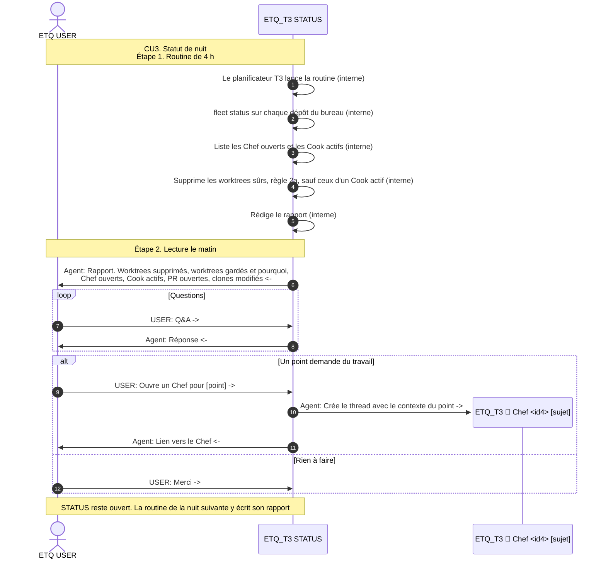

# CU3. Statut de nuit

> Not approved. Never run this CU. [brigade-mode](../../SKILL.md)

Chaque nuit à 4 h, STATUS fait le ménage sûr, puis rédige le rapport que l'utilisateur lit le matin. La règle 2a du diagramme : un worktree n'est supprimé que si sa PR est mergée, sans fichier modifié ni commit non poussé. Un worktree utilisé par un Cook actif, non settlé, est gardé même si sa PR est mergée. Ce cas n'est pas encore construit, pas plus que la commande `fleet status` du diagramme.

## Related

- CU1, le flux d'un Chef ouvert depuis le rapport
- CU2, les Cook que le rapport liste comme actifs
