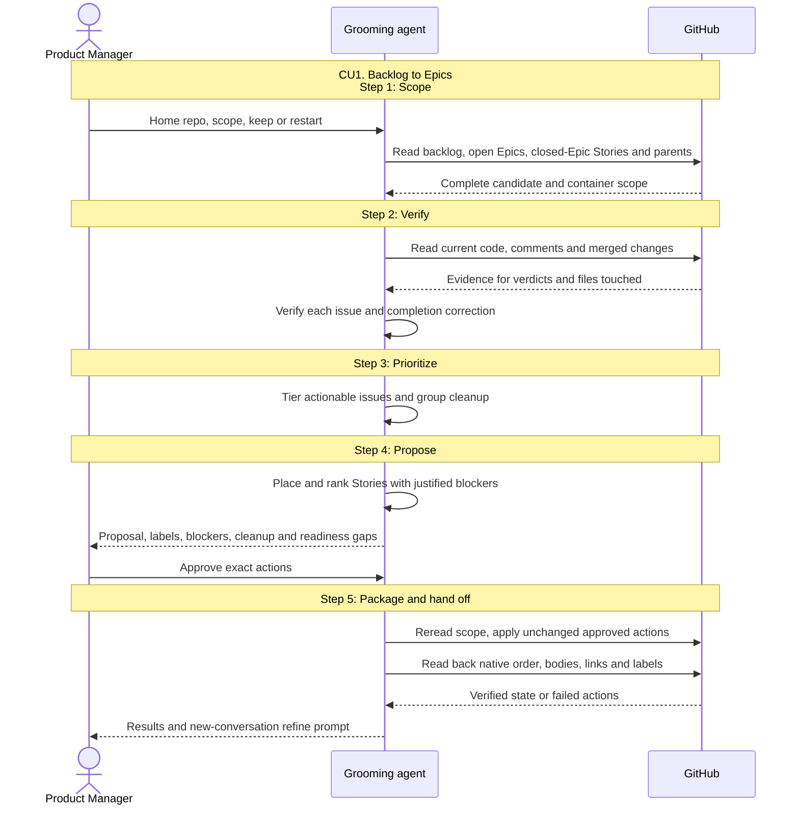

# CU1. Backlog to Epics

```
Epic progress:
- [ ] 1. Scope
- [ ] 2. Verify
- [ ] 3. Prioritize
- [ ] 4. Propose
- [ ] 5. Package and hand off
```

## Process

1. **Scope.** Resolve the home repo and scoped repos. For existing open Epics,
   reuse the Product Manager's explicit choice or obtain it:

   - Keep: place a Story in a kept Epic when its outcome covers it; otherwise
     propose a new Epic
   - Restart: record the exact Epics. Close a complete one as completed. Detach an
     incomplete one's open Stories, close it as not planned, preserve its body,
     and comment where each detached Story goes

   Default scope is each repo's backlog, open Stories whose Epic is closed,
   and open Epics with all their Stories, open or closed. For another requested
   set such as a label, use that set plus open Epics and their Stories.
   Inspect parents with the children filter so closed-Epic Stories remain visible
   and Sub-tasks follow their non-Epic parent's placement under the Membership rule.
   Done when every candidate and container is read and counted
2. **Verify.** Apply the shared verdicts against current code and merged changes.
   Flag complete open Epics and wrongly completed issues. Identify the files each
   actionable Story touches, including cross-repo paths.
   Done when every issue has an evidenced verdict or a precise left-out reason
3. **Prioritize.** Weigh observed recurrence and cost against estimated effort.
   Identify areas collecting findings and recent PRs leaving problems unresolved.
   State uncertainty. Tier actionable issues under Labels and bodies.
   Group duplicates or issues one change fixes and list cleanup.
   Done when every actionable issue has a tier or cleanup reason
4. **Propose.** Use SKILL.md's Proposal form. Place every actionable issue into
   exactly one Epic by outcome. A one-Story Epic is allowed only when no other
   Epic can take it. Apply label-for-issues' Dependencies rule within each Epic
   and between Epics whose Stories have file conflicts. Link the later Epic
   blocked by the earlier one using the shared Epic order.
   Ground other waits in current acceptance criteria or code prerequisites.
   A possible future rewrite does not justify a wait when the Story can ship
   against the current default branch. Check Parallel against the full graph.
   Set Story Rank in native order and the same Epic body order.
   Done when the proposal accounts for every scoped issue and the Product Manager
   approves, or receives the proposal as the read-only result
5. **Package and hand off.** Follow the shared approval/apply/readback checklist.
   Create all new Epics in approved order, then resolve their numbered references.
   Without a Milestone, this creation order is their initial Rank.
   Apply approved completion corrections, cleanup and restart dispositions.
   Attach Stories one at a time in Rank order, reorder existing native relations
   as needed, set justified blocked-by links and approved labels, and update
   open Epic bodies to match actual Stories, including closed Stories.
   Preserve the bodies of retired or already closed Epics.
   Report kept and new Epics with URLs and Story counts, applied cleanup,
   failed actions, left-out issues and each Epic's gap to the Definition of Ready.
   Give one shared `refine` prompt per Epic, each with its actual reference.
   When two or more Epics lack a Milestone, suggest `grooming-mode ; milestone`
   as an option; the Product Manager may finish assembling Epics first.
   Done when every write is read back and the refinement handoff is explicit

## Sequence


