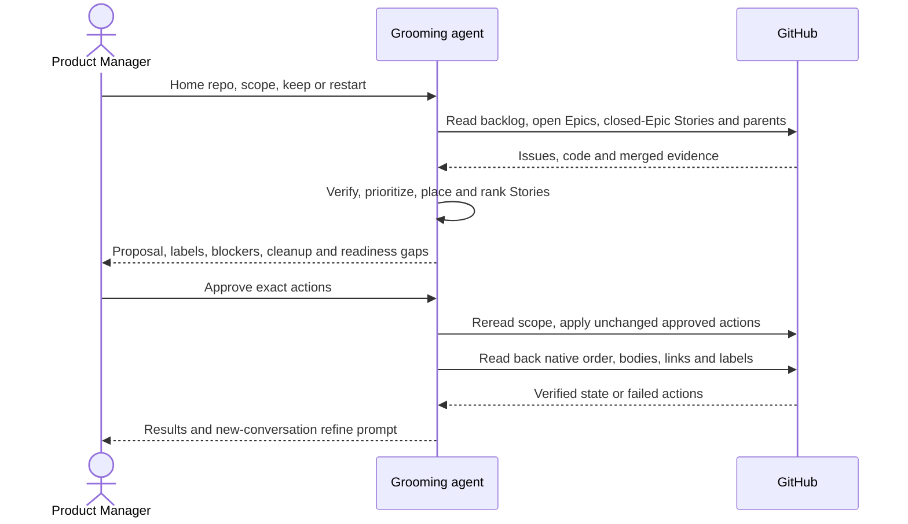

# CU1. Backlog to Epics

Use SKILL.md's shared rules and inline glossary throughout this process.

```
Epic progress:
- [ ] 1. Scope
- [ ] 2. Verify
- [ ] 3. Prioritize
- [ ] 4. Propose
- [ ] 5. Package and hand off
```

## Process

1. **Scope.** Resolve the home repo, scoped repos and keep/restart choice.
   Default scope is each repo's backlog, open Stories whose Epic is closed,
   and open Epics with all their Stories, open or closed. For another requested
   set such as a label, use that set plus open Epics and their Stories.
   Inspect parents with the children filter so closed-Epic Stories remain visible
   and Sub-tasks stay with their parents. Read closed issues the set references
   for evidence and closing-reason corrections.
   Done when every candidate and container is read and counted
2. **Verify.** Apply the shared verdicts against current code and merged changes.
   Flag complete open Epics and wrongly completed issues. Identify the files each
   actionable Story touches, including cross-repo paths.
   Done when every issue has an evidenced verdict or a precise left-out reason
3. **Prioritize.** Weigh observed recurrence and cost against estimated effort.
   Identify areas collecting findings and recent PRs leaving problems unresolved.
   State uncertainty. Tier actionable issues P1, at most three, P2 and P3.
   Group duplicates or issues one change fixes and list cleanup.
   Done when every actionable issue has a tier or cleanup reason
4. **Propose.** Use the Epic template. Place every actionable issue into exactly
   one Epic by outcome, including unready Stories whose outcome fit is supported.
   A one-Story Epic is allowed only when no other Epic can take it. Keep Stories
   touching the same files in the same Epic and link later work blocked by earlier
   work where it must wait. Explain each link. Without a real wait, show parallel
   work without a link. Set Story Rank in native order and the same Epic body order;
   order proposed Epics by prerequisites, then return. Add only justified
   blocked-by links between Epics CU1 creates.
   Show every Story's verdict, evidence, Today, After, tier, exact priority and
   state labels, Rank, target Epic and blockers. Show each kept or new Epic's
   priority, state, outcome, checkable Done when and remaining readiness gaps.
   Include cleanup, left-out issues with missing evidence, moves, and exact
   closure/reopening comments. Preserve Story bodies; send missing goals,
   acceptance criteria or user decisions to CU3.
   Done when the proposal accounts for every scoped issue and the Product Manager
   approves, or receives the proposal as the read-only result
5. **Package and hand off.** Follow the shared approval/apply/readback checklist.
   Create all new Epics in approved order, then resolve their numbered references.
   Apply approved completion corrections, cleanup and restart dispositions.
   Attach Stories one at a time in Rank order, reorder existing native relations
   as needed, set justified blocked-by links and approved labels, and update
   open Epic bodies to match actual Stories, including closed Stories.
   Preserve the bodies of retired or already closed Epics.
   Report kept and new Epics with URLs and Story counts, applied cleanup,
   failed actions, left-out issues and each Epic's gap to grooming Done when.
   Finish with the shared CU3 prompt, using real Epic references.
   Done when every write is read back and the refinement handoff is explicit

## Sequence

The Product Manager approves the whole proposal; packaging proves native GitHub
state, then hands readiness gaps to a new refinement conversation.


