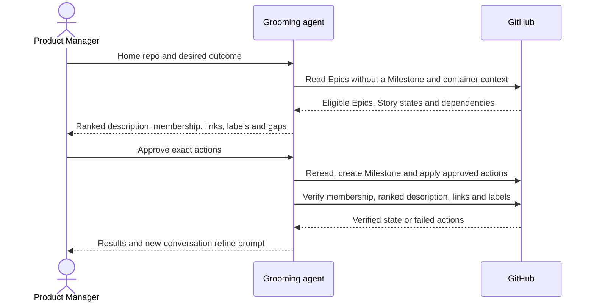

# CU2. Epics to a Milestone

Use SKILL.md's shared rules and inline glossary throughout this process.

```
Milestone progress:
- [ ] 1. Scope containers
- [ ] 2. Propose
- [ ] 3. Package and hand off
```

## Process

1. **Scope containers.** Resolve the home repo and read its open Epics without
   a Milestone with label-for-issues' filter. Read their bodies, Story states,
   labels and dependencies as container context; CU2 does not reverify Story code.
   An issue outside any Epic stays aside with "run grooming-mode ; epic first".
   An Epic already in another Milestone stays outside this route's proposal.
   Done when all eligible Epics and excluded issues are accounted for
2. **Propose.** Use the Milestone template. Number `M<N> · <outcome>` after the
   highest existing M number, closed Milestones included. List each Epic by Rank
   with its issue number and the reason for that place. Add a native blocked-by
   link only when one Epic really must wait for another; show parallel work
   without a link. Show the proposed Milestone description, membership, links
   and exact Story/Epic priority and readiness labels under the shared rules.
   Use each Story's recorded tier; flag an unsettled tier for approval.
   Preserve Story bodies and name each Epic's gap to grooming Done when.
   Done when the Product Manager approves the complete proposal, or receives
   the proposal as the read-only result
3. **Package and hand off.** Follow the shared approval/apply/readback checklist.
   Create the Milestone with its ranked description, assign it only to approved
   home-repo Epics and apply approved dependencies and labels. Report its URL,
   Epics by Rank, parallel work, excluded issues and remaining readiness gaps.
   Finish with the shared CU3 prompt using the real Milestone URL.
   Done when every write is read back and refinement has its target

## Sequence

Epic Rank has one persistent owner, the Milestone description. Story refinement
continues in a new conversation.


