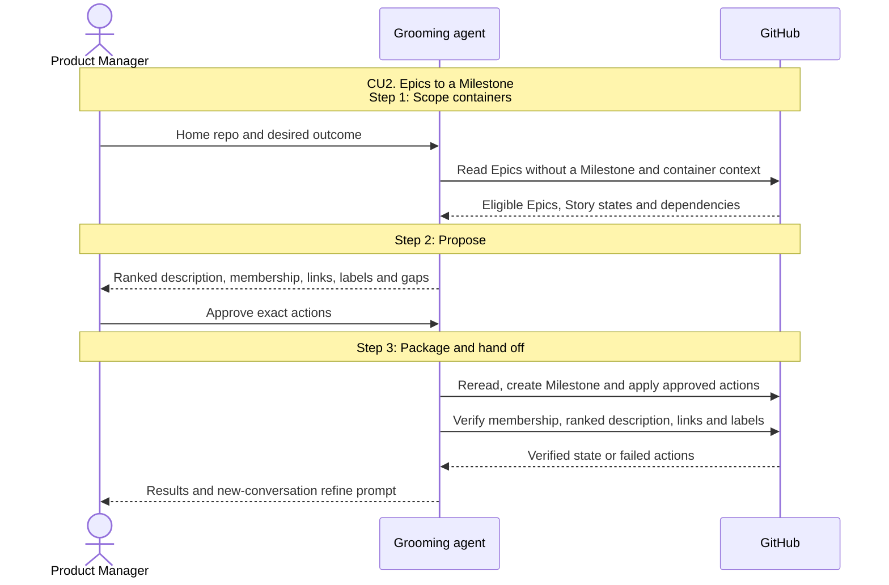

# CU2. Epics to a Milestone

```
Milestone progress:
- [ ] 1. Scope containers
- [ ] 2. Propose
- [ ] 3. Package and hand off
```

## Process

1. **Scope containers.** Resolve the home repo and read its open Epics without
   a Milestone with label-for-issues' filter. Read their bodies, Story states,
   labels and dependencies as container context; `milestone` does not reverify Story code.
   Leave an issue outside any Epic on the left-out list with "run grooming-mode ; epic first".
   Leave an Epic already in another Milestone on the left-out list.
   Done when all eligible Epics and left-out issues are accounted for
2. **Propose.** Use SKILL.md's Proposal form and shared Epic order.
   Number `M<N> · <outcome>` after the highest existing M number, closed Milestones
   included. Apply label-for-issues' Dependencies rule and check Parallel.
   Use each Story's recorded tier; flag an unsettled tier for approval.
   Done when the Product Manager approves the complete proposal, or receives
   the proposal as the read-only result
3. **Package and hand off.** Follow the shared approval/apply/readback checklist.
   Create the Milestone with its ranked description, assign it only to approved
   home-repo Epics and apply approved dependencies and labels. Report its URL,
   Epics by Rank, parallel work, left-out issues and remaining readiness gaps.
   Finish with the shared `refine` prompt using the real Milestone URL.
   Done when every write is read back and refinement has its target

## Sequence


