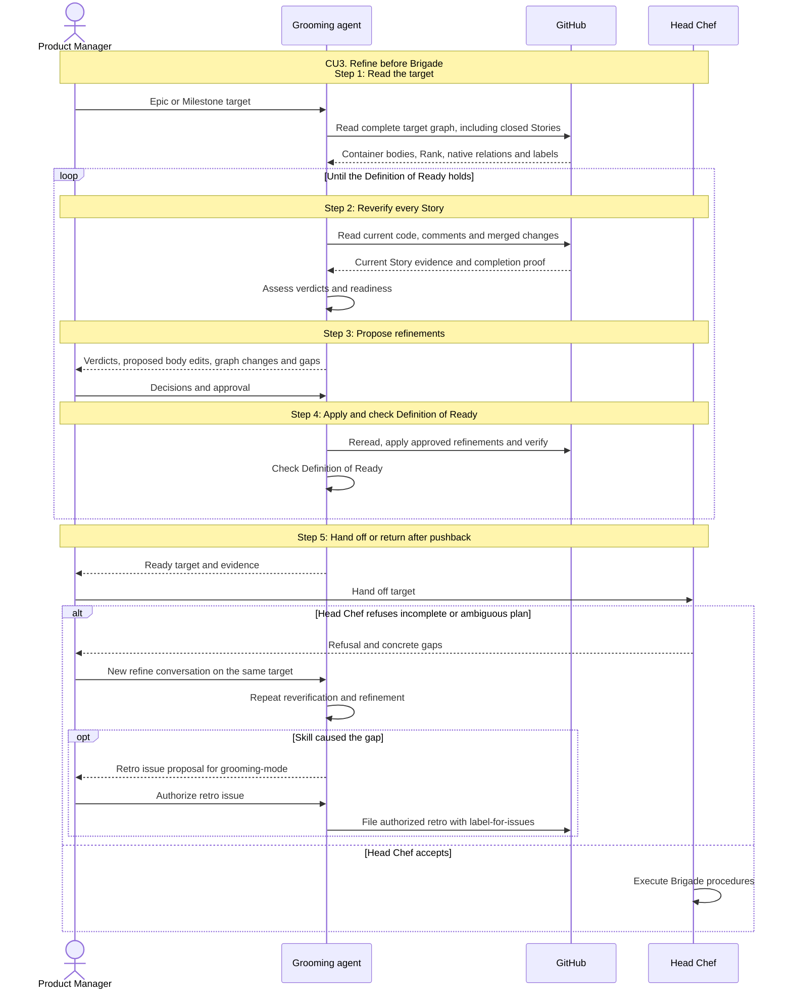

# CU3. Refine before Brigade

```
Refine progress:
- [ ] 1. Read the target
- [ ] 2. Reverify every Story
- [ ] 3. Propose refinements
- [ ] 4. Apply and check Definition of Ready
- [ ] 5. Hand off or return after pushback
```

## Process

1. **Read the target.** In this new conversation, resolve the home repo and an
   Epic or Milestone reference. Read the container bodies, Epic Rank, all Stories,
   native order, parents, blockers and labels with full pagination.
   For Epics without a Milestone, preserve their order and suggest
   `grooming-mode ; milestone` to persist Epic Rank.
   Done when the entire target graph is read, including closed Stories
2. **Reverify every Story.** Apply the shared verdicts against each repo's current
   default branch and merged evidence. Check non-code completion comments.
   Flag complete Epics, wrong closing reasons, duplicates and missing evidence.
   Check each Story's goal, acceptance criteria, dependencies and open decisions.
   Done when every Story has a proven verdict and readiness assessment, or the
   precise reason proof is missing is reported
3. **Propose refinements.** Use SKILL.md's Proposal form. Ground Story body edits
   in evidence and the Product Manager's decisions. When evidence or a decision
   is missing, name the required input, keep the target unready and wait;
   resume step 2 when it arrives.
   Done when the proposal is approved, delivered as read-only, or missing input is reported
4. **Apply and check Definition of Ready.** Follow the shared approval/apply/readback
   checklist. Apply approved Story body edits. Reassess labels with
   the Ready rule and verify the actual graph against all Definition of Ready
   conditions. For missing input, follow step 3's wait; for other gaps, return to
   step 2 with another proposal.
   Done when the Definition of Ready holds, or the precise missing input is reported
5. **Hand off or return after pushback.** Only when the Definition of Ready holds,
   give Brigade the actual target and readiness evidence. If its Head Chef refuses,
   return the refusal to the Product Manager with the shared `refine` prompt on
   the same target and the refusal's gaps, for them to launch a new conversation.
   If the skill itself caused the gap, propose a grooming-mode retrospective issue
   with the failing instruction, observed behavior and needed correction; create
   it only when issue creation is authorized, through label-for-issues.
   Done when the ready target is handed off, or pushback has a named next action

## Sequence


