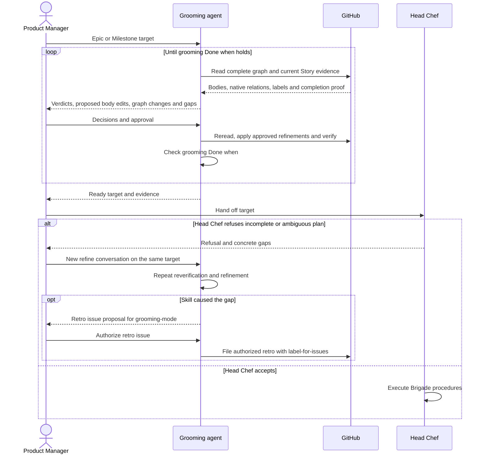

# CU3. Refine before Brigade

Use SKILL.md's shared rules and inline glossary throughout this process.

```
Refine progress:
- [ ] 1. Read the target
- [ ] 2. Reverify every Story
- [ ] 3. Propose refinements
- [ ] 4. Apply and check Done when
- [ ] 5. Hand off or return after pushback
```

## Process

1. **Read the target.** In this new conversation, resolve the home repo and an
   Epic or Milestone reference. Read the container bodies, Epic Rank, all Stories,
   native order, parents, blockers and labels with full pagination.
   Done when the entire target graph is read, including closed Stories
2. **Reverify every Story.** Apply the shared verdicts against each repo's current
   default branch and merged evidence. Check non-code completion comments.
   Flag complete Epics, wrong closing reasons, duplicates and missing evidence.
   Check each Story's goal, acceptance criteria, dependencies and open decisions.
   Done when every Story has a current verdict and a readiness assessment
3. **Propose refinements.** Show exact Story body edits for unclear goals and
   acceptance criteria, supported by evidence and the Product Manager's decisions.
   Ask for decisions evidence cannot settle; keep the Story unready meanwhile.
   Propose needed placement, Story/Epic Rank, blocked-by links, labels, cleanup
   and container edits with the shared templates. Keep one owner per Rank.
   Show all comments, left-out issues and gaps against each Done when condition.
   Done when the complete proposal is approved, or delivered as read-only
4. **Apply and check Done when.** Follow the shared approval/apply/readback
   checklist. CU3 alone applies approved Story body edits. Reassess labels with
   the Ready rule and verify the actual graph against all grooming Done when
   conditions. If gaps remain, return to step 2 with another proposal; when
   evidence or a human decision is missing, name it and wait.
   Done when grooming Done when holds, or the precise missing input is reported
5. **Hand off or return after pushback.** Give Brigade the actual target and
   readiness evidence. Its Head Chef can refuse an incomplete or ambiguous plan.
   Return that refusal to the Product Manager, start another `refine` conversation
   on the same target, and repeat steps 1 to 4. A content gap stays in refinement.
   If the skill itself caused the gap, propose a grooming-mode retrospective issue
   with the failing instruction, observed behavior and needed correction; create
   it only when issue creation is authorized, through label-for-issues.
   Brigade's acceptance criteria, launches and batches belong to Brigade.
   Done when the ready target is handed off, or pushback has a named next action

## Sequence

Only refinement pursues grooming Done when. A Head Chef refusal sends the plan
back through the Product Manager, with a separate retro for skill defects.


