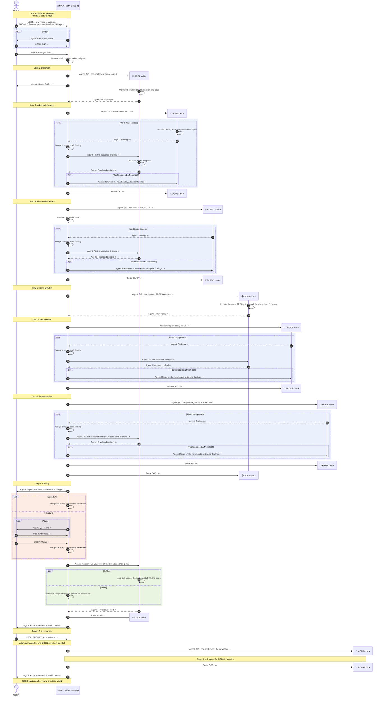

# CU1. Rounds in one MAIN

Pascal runs successive rounds in one MAIN. Each round implements one card with one COD, runs the reviews one at a time, and ends on the merge and the retros. The example runs two rounds: round 1 removes personal data from skill-xyz, and round 2, summarized, hands another issue to a second COD.

## Process

MAIN runs each step in order and launches each thread with `main-launch`.

| # | Step | Threads | SOP |
|---|---|---|---|
| 0 | Align | MAIN, Pascal | Before `$s3`: MAIN and Pascal agree on the plan |
| 1 | Implement | COD<n> | `cod-implement` |
| 2 | Adversarial review | ADV<n>, then MAIN | `rev-adverse`, `main-triage` |
| 3 | Blast-radius review | BLAST<n>, then MAIN | `rev-blast-radius`, `main-triage` |
| 4 | Docs updates | DOC<n> | `doc-update` |
| 5 | Docs review | RDOC<n>, then MAIN | `rev-docs`, `main-triage` |
| 6 | Pristine review | PRIS<n>, then MAIN | `rev-pristine`, `main-triage` |
| 7 | Closing | MAIN, COD<n> | `main-closing` |

Fast track skips each step whose role sets `skip-in-fast-track` in `config.toml`.

## Diagram

Each step opens with a banner that holds its number and name from the process table, such as `Step 1: Implement`.

- Every message said in a chat starts with `USER:` or `Agent:`
- A marker ends each message: `->` to the right, `<-` to the left. A thread's own action is an arrow back to itself, with no marker
- "Settle" has no prefix, since it is a T3 action and not a message
- The first banner holds the CU title
- Blue boxes are loops, green boxes run in parallel, and orange boxes are alternatives
- `PR 35` and `PR 36` are example PR numbers
- The Mermaid source writes `;` as `#59;`, since Mermaid reads it as the end of a statement, and uses no `#`, which starts a comment

