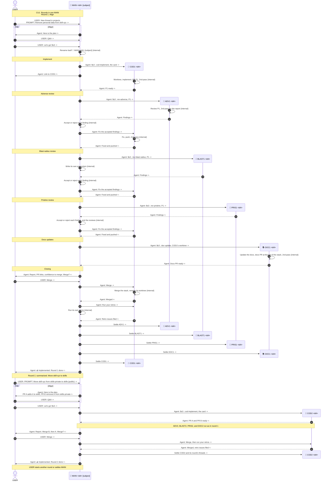

# CU1. Rounds in one MAIN

Pascal runs successive rounds in one MAIN. Each round implements one card with one COD, runs the reviews one at a time, and ends on the merge and the retros. The example runs two rounds: round 1 removes personal data from skill-xyz, and round 2, summarized, moves skill-xyz from skills-private to skills.

## Process

MAIN runs each step in order and launches each thread with `main-launch`.

| # | Step | Threads | SOP |
|---|---|---|---|
| 1 | Align | MAIN, Pascal | Before `$s3`: MAIN and Pascal agree on the plan |
| 2 | Implement | COD<n> | `cod-implement` |
| 3 | Adverse review | ADV<n>, then MAIN | `rev-adverse`, `main-triage` |
| 4 | Blast-radius review | BLAST<n>, then MAIN | `rev-blast-radius`, `main-triage` |
| 5 | Pristine review | PRIS<n>, then MAIN | `rev-pristine`, `main-triage` |
| 6 | Docs updates | DOC<n> | `doc-update` |
| 7 | Closing | MAIN, COD<n> | `main-closing` |

Fast track skips steps 3 to 5.

## Diagram

Each step opens with a banner that holds its step name from the process table.

- Every message said in a chat starts with `USER:` or `Agent:`
- A marker ends each message: `->` to the right, `<-` to the left, `(internal)` for a thread's own action
- "Settle" has no prefix, since it is a T3 action and not a message
- The first banner holds the CU title

