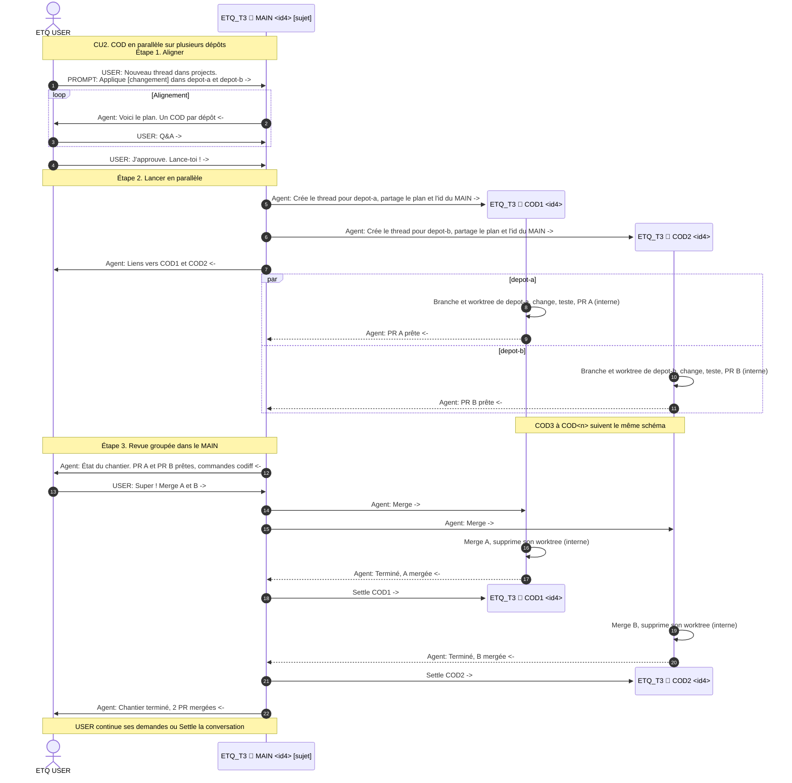

# CU2. COD en parallèle sur plusieurs dépôts

> Not approved. Never run this CU. [s3](../SKILL.md)

Le MAIN lance un COD par dépôt en même temps. Il regroupe les revues dans un seul message, puis settle chaque COD dès son merge.

## Related

- CU1, des rounds successifs avec un COD à la fois
- CU3, le rapport de 4 h qui liste les COD actifs
