# CU1. Batches under one Head Chef

For Pascal designing the route in VS Code. This illustrative sequence shows who owns each handoff: the Head Chef launches each Cook; the Cook owns its loops, watches, merge and closing.

A CU is a use case showing the process between Pascal and the threads. When an SOP step changes, update the process table in `gravlax.md` and this diagram wherever they show that step. The status model in `references/model.py` does not cover this route yet: https://github.com/pascalandy/skills/issues/1172. Agents executing SOPs do not read this file.

## Conventions

Each step starts with its number and name. Chat messages start with `USER:` or `Agent:` and end with `->` or `<-` for direction. Self-arrows show local actions and delegates, which have no participant. Settle is a T3 action. Blue boxes show loops and orange boxes alternatives. PR numbers are examples. In sequence labels, write `;` as `#59;` and `#` as `#35;`. Bare `;` ends a statement; bare `#` drops its remainder without an error.

## Sequence

```mermaid
%%{init: {"sequence": {"diagramMarginX": 100}}}%%
sequenceDiagram
    accTitle: CU1 without the Chef
    accDescr: One Cook per batch reviews a single stack, proves it and merges by purpose. The Head Chef settles doubts, asks Pascal for hard stops and reports long batches before counting delivery.
    autonumber
    actor U as USER
    participant H as Head Chef
    participant K as Cook 1.1
    Note over U,K: CU1. Batches under one Head Chef<br>Step 0: Align
    U->>H: USER: Plan and requirements ->
    H->>U: Agent: Goal, batches with acceptance criteria,<br>choices from Decisions <-
    opt A question the plan leaves open
        H->>U: Agent: 🙋 Plain question, why needed,<br>cost of no and URL <-
        U->>H: USER: Answer ->
    end
    H->>H: Pin, register batches<br>❓ align only for an open question
    H->>H: Arm the run's only Watchdog<br>Delegate owns its schedule<br>Check its bound thread
    H->>H: Decide overlaps with open PRs<br>outside the run
    H->>H: New repository card: create, clone,<br>push empty commit, set origin/HEAD<br>Create Cook worktree, register slot
    H->>K: Agent: Launch 🍳 Cook with every card ->
    Note over H,K: The Watchdog is a hidden delegate, not a participant<br>Each tick reads watch and wake files
    opt Cook stalls or fails
        H->>H: Watchdog queues one Cook wake<br>then alerts Head Chef after max-wakes
        H->>H: Reconcile effects, resume<br>or replace Cook in its slot
    end
    opt A progress-hours interval passes without Batch ready or merge
        H->>H: Watchdog alerts once per threshold<br>Head Chef otherwise sleeps
        H->>U: Agent: Lot 1, cards with PR / cards,<br>hours, longest step, recommendation if no new PR <-
    end
    Note over H,K: Step 1: Implement, one card at a time
    loop Each card in Plan order
        opt Bug card
            K->>K: diagnose before reading source
            K-->>H: Agent: ⏸️ question for Pascal <-
        end
        K->>K: Set card and starting Epic to 1-wip-by-agent<br>New layer, 2nd-pass, push, file-pr: PR 35
        rect rgba(137, 180, 250, 0.2)
            loop Loop 1 on PR 35, until it ends
                K->>K: Isolated review-loop round, base and head SHAs<br>manic-1 and manic-2, other provider
                K->>K: Fix in the layer, push<br>Ledger: fixed, declined, disputed
            end
        end
    end
    Note over K: Watch findings: queue while a round runs,<br>otherwise triage at once
    Note over H,K: Step 2: Docs
    K->>K: andy-mode docs in each card's layer<br>PR 37 on top only for docs no card owns<br>Release yes: final content layer
    opt Step 2 opened a PR
        K->>K: Loop 1 on that PR
    end
    Note over H,K: Step 3: Loop 2 on the whole stack
    rect rgba(137, 180, 250, 0.2)
        loop Loop 2 on PR 35–37, until it ends
            K->>K: Isolated review-loop round, base and head SHAs<br>manic-3 and manic-5, other provider
            opt A fix changes shipped behavior
                K->>K: Fix and push
                par Changed PRs
                    K->>K: Loop 1
                and Combined stack
                    K->>K: Loop 2
                end
            end
        end
    end
    Note over H,K: Step 4: Proof
    K->>K: Real data: run restore before live proof<br>or merging a scheduled destructive job<br>Secret files: path, status and count only
    K->>K: Evidence for every criterion in its PR<br>babysit checks and bots
    Note over H,K: Step 5: Merge gate, merge and release
    K->>K: Freeze the stack
    rect rgba(239, 159, 118, 0.2)
        alt Every gate purpose met and no open hard stop
            K-->>H: Agent: 🔀 Batch 1 merging <-
        else Real doubt or open hard stop
            K-->>H: Agent: 🍽️ Batch ready, evidence and recommendation <-
            H->>H: Decide and record Detail
            opt Open hard stop
                H->>U: Agent: 🙋 Action, why needed,<br>cost of no and URL <-
                U->>H: USER: Answer ->
            end
            H->>K: Agent: 🔀 Merge, ⏳ Rework or 🍽️ Hold<br>⏹️ Drop only from Pascal ->
        end
    end
    K->>K: Verify GitHub heads,<br>merge in its worktree
    opt Merge fails
        K->>K: 🍳 Fix the cause, checks and loops,<br>Proof, merge gate again
    end
    Note over H,K: Approval follows shipped behavior<br>Same base and top tree prove a restack keeps it<br>New heads still need checks
    K-->>H: Agent: Batch merged, deploy result<br>No Head Chef count yet <-
    K->>K: Release yes: finish procedure<br>from main
    Note over H,K: Step 6: Closing
    rect rgba(239, 159, 118, 0.2)
        alt Every child closed and each Done when holds
            K->>K: Close each merged card's Epic, clear state<br>Reserved closing: 1-ready-for-human instead
        else Pending child or Done when item
            K->>K: Keep Epic open, name every pending item
        end
    end
    K->>K: 🧹 Labels, retros, unwatch<br>Delete merged GitHub heads with SHA-bound lease<br>Keep moved tips or branches the project keeps<br>Remove work folder
    K-->>H: Agent: ⛳ Batch delivered, report <-
    K->>K: Settle
    H->>H: Confirm Cook settled,<br>remove its merged worktree
    H->>H: Count only delivered batches<br>Next batches, retros
    H->>H: Read GitHub items waiting on Pascal<br>No Stop: apply decisions, Coordinate added work<br>Stop: report follow-up URLs, add no batch
    H->>U: Agent: ⛳ x/y batches done, report <-
    H->>H: Delete Watchdog schedule<br>cancel task, remove work folders<br>Prune worktree records
    H->>H: Settle and unpin
```

The Head Chef's decision or Pascal's answer may produce `⏳ Rework` or `🍽️ Hold`; only Pascal can `⏹️ Drop`. Rework returns the Cook to 🍳. Hold keeps it 🍽️; `❓ held batch <b>` appears once nothing else can progress. Drop closes it at ⏹️ and removes the cut batch from the count.

Fast track implements required release content, skips docs and both loops, then goes to Proof and the same merge gate. A batch without PRs runs in its Cook alone and goes to Closing. On `⏹️ Stop`, the Head Chef tells each Cook; a merge or release already running finishes, then each Cook follows Closing and closes at ⛳ for a merged and released batch, otherwise ⏹️.
