# CU1. Batches under one Head Chef

For Pascal designing the route in VS Code. This illustrative sequence shows who owns each handoff: the Head Chef launches each Cook; the Cook owns its loops, watches, merge and closing.

A CU is a use case showing the process between Pascal and the threads. When an SOP step changes, update the process table in `gravlax.md` and this diagram wherever they show that step. The status model in `references/model.py` does not cover this route yet: https://github.com/pascalandy/skills/issues/1172. Agents executing SOPs do not read this file.

## Conventions

Each step starts with its number and name. Chat messages start with `USER:` or `Agent:` and end with `->` or `<-` for their direction. Self-arrows show local actions and delegate calls; reviewers are absent from the sidebar, so they have no participant. Settle is a T3 action. Blue boxes show loops, green boxes parallel work and orange boxes alternatives. `PR 35` and `PR 36` are examples. In sequence labels, including message and note text, write `;` as `#59;` and `#` as `#35;`. A bare `;` ends the statement, and a bare `#` drops the remaining text without an error.

## Sequence

```mermaid
%%{init: {"sequence": {"diagramMarginX": 100}}}%%
sequenceDiagram
    accTitle: CU1 without the Chef
    accDescr: The Head Chef alone asks Pascal and launches one Cook per batch. Each Cook runs loop 1 on each PR and loop 2 on the whole stack, then merges, releases and closes before the Head Chef counts delivery.
    autonumber
    actor U as USER
    participant H as Head Chef
    participant K as Cook 1.1
    Note over U,K: CU1. Batches under one Head Chef<br>Step 0: Align
    U->>H: USER: Plan and requirements ->
    H->>U: Agent: Goal, batches with acceptance criteria,<br>choices from Decisions <-
    opt A question the plan leaves open
        H->>U: Agent: 🙋 align, batches that do not wait on it launch <-
        U->>H: USER: Answer ->
    end
    H->>H: Pin, register batches<br>❓ align only for an open question
    H->>H: Arm the run's only Watchdog<br>Delegate owns its schedule<br>Check its bound thread
    H->>H: Decide overlaps with open PRs<br>outside the run
    H->>H: Create the Cook's worktree<br>register its slot
    H->>K: Agent: Launch 🍳 Cook with every card ->
    Note over H,K: The Watchdog is a hidden delegate, not a participant<br>Each tick reads watch and wake files
    opt Cook stalls or fails
        H->>H: Watchdog queues one Cook wake<br>then alerts Head Chef after max-wakes
        H->>H: Reconcile effects, resume<br>or replace Cook in its slot
    end
    Note over H,K: Step 1: Implement, one card at a time
    loop Each card in Plan order
        opt Bug card
            K->>K: diagnose before reading source
            K-->>H: Agent: ⏸️ question for Pascal <-
        end
        K->>K: poteto-mode on a new layer<br>2nd-pass, push, file-pr: PR 35
        rect rgba(137, 180, 250, 0.2)
            loop Loop 1 on PR 35, until it ends
                K->>K: Delegate review-loop round<br>manic-1 and manic-2 angles<br>Other provider
                K->>K: Fix in the layer, push<br>Ledger: fixed, declined, disputed
            end
        end
    end
    Note over K: Watch findings: queue while a round runs,<br>otherwise triage at once
    Note over H,K: Step 2: Docs
    K->>K: andy-mode docs in each card's layer<br>PR 37 on top only for docs no card owns<br>Release yes: final content layer
    opt Step 2 opened a PR
        K->>K: Loop 1 on that PR
    end
    Note over H,K: Step 3: Loop 2 on the whole stack
    rect rgba(137, 180, 250, 0.2)
        loop Loop 2 on PR 35–37, until it ends
            K->>K: Delegate review-loop round<br>manic-3 and manic-5 angles<br>Other provider
            K->>K: Fix, push#59; a behavior fix<br>sends its PR back through loop 1
        end
    end
    Note over H,K: Step 4: Proof
    K->>K: full-send Proof for every criterion<br>evidence pasted in each PR<br>babysit-pr to green, bots finished
    Note over H,K: Step 5: Merge gate, merge and release
    K->>K: Freeze the stack
    rect rgba(239, 159, 118, 0.2)
        alt Every merge gate holds#59; Pareto verdict challenged with sparring
            K-->>H: Agent: 🔀 Batch 1 merging <-
        else A gate fails
            K-->>H: Agent: 🍽️ Batch ready, failed gate<br>and recommendation <-
            alt Requirements or specs settle a question
                H->>K: Agent: Answers from requirements or specs ->
                K-->>H: Agent: Merge rule again: 🔀 Batch 1 merging<br>or a new 🍽️ Batch ready <-
            else Gate still open
                H->>U: Agent: 🙋 merge PR 35–37 URL ? failed gate and recommendation <-
                U->>H: USER: Merge ->
                H->>K: Agent: 🔀 Merge ->
            end
        end
    end
    K->>K: Verify GitHub heads,<br>merge in its worktree
    opt Merge fails
        K->>K: 🍳 Fix the cause, checks and loops,<br>Proof, merge gate again
    end
    Note over H,K: Restack on main: same own diff keeps approval#59;<br>changed diff needs a new decision
    K-->>H: Agent: Batch merged, deploy result<br>No Head Chef count yet <-
    K->>K: Release yes: finish procedure<br>from main
    Note over H,K: Step 6: Closing
    rect rgba(239, 159, 118, 0.2)
        alt All children closed, no reserve
            K->>K: Close Epic with child proof
        else All closed, body reserves closing for Pascal
            K->>K: Keep Epic open, swap 1-wip-by-agent<br>for 1-ready-for-human
        else A child stays open
            K->>K: Neither, name the open children
        end
    end
    K->>K: 🧹 Labels, retros, unwatch,<br>remove work folder
    K-->>H: Agent: ⛳ Batch delivered, report <-
    K->>K: Settle
    H->>H: Confirm Cook settled,<br>remove its merged worktree
    H->>H: Count only delivered batches<br>Next batches, retros
    H->>H: Read GitHub items waiting on Pascal<br>No Stop: apply decisions, Coordinate added work<br>Stop: report follow-up URLs, add no batch
    H->>U: Agent: ⛳ x/y batches done, report <-
    H->>H: Delete Watchdog schedule<br>cancel task, remove work folders<br>Prune worktree records
    H->>H: Settle and unpin
```

At review, Pascal may instead choose `⏳ Rework`, `🍽️ Hold` or `⏹️ Drop`. Rework returns the Cook to 🍳 and may withdraw ❓. Hold keeps the Cook 🍽️; the Head Chef shows `❓ held batch <b>` once no other work can progress. Drop closes the Cook at ⏹️, and the cut batch leaves the Head Chef's count.

Fast track implements required release content, skips docs and both loops, then goes to Proof and the same merge gate. A batch without PRs runs in its Cook alone and goes to Closing. On `⏹️ Stop`, the Head Chef tells each Cook; a merge or release already running finishes, then each Cook follows Closing and closes at ⛳ for a merged and released batch, otherwise ⏹️.
