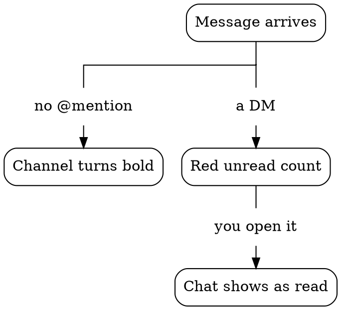

# Graphviz

Draw each diagram as vertical lanes, like the lifelines of a sequence diagram. Each lane is one straight column from top to bottom. Each edge turns at right angles.

## Prerequisite

To check that Graphviz is installed, run `dot -V`. If the command fails, install Graphviz with `brew install graphviz` on macOS or `sudo pacman -S graphviz` on Arch Linux.

## Lanes

Set these attributes:

- `splines=ortho` on the graph, for right-angle edges
- `ordering=out` on the graph, to keep the branches in source order
- `group=<lane>` on each node of a lane, to keep the lane in one straight column

`splines=ortho` has two limits. Use these workarounds:

- With `splines=ortho`, Graphviz cannot place edge labels. Put each label in a `shape=plaintext` node on its edge. Give the label node the group of the node that the edge points to
- Edges from a node with many branches can leave from different sides and cross. Under that node, add a junction point: a `shape=point` node with a width and height of 0.01. Give the junction point the group of that node. Draw each branch from the junction point

An edge into a label node or a junction point has no arrowhead. Set `arrowhead=none` on that edge.

If the lines between two rows are too close, increase `ranksep`.

## Example

This source has a junction point under `msg`, three label nodes, and two lanes:

## Check

The PNG must show these three results:

- Each lane is one straight column
- No edge crosses a label
- The branches keep the source order

1. Render a PNG with `dot -Tpng -Gdpi=150 diagram.dot -o diagram.png`
2. Compare the PNG with the three results
3. If a result is missing, fix the source
4. Repeat steps 1 to 3 until the PNG shows the three results
