## Edges on one side of a node

### Two-way pair

An arrowhead and the edge that leaves beside it should not touch.

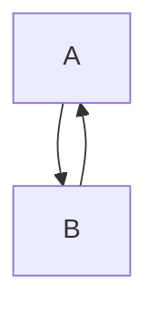

### Two-way pairs in a triangle

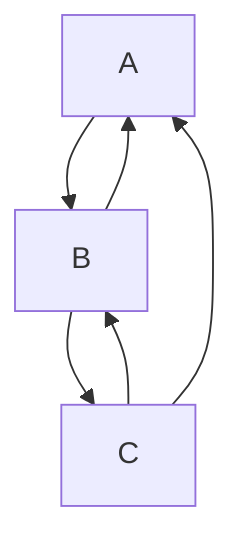

### Diamond with an edge back to it

Three edges on the tip of the diamond, and one in and one out on top of F.

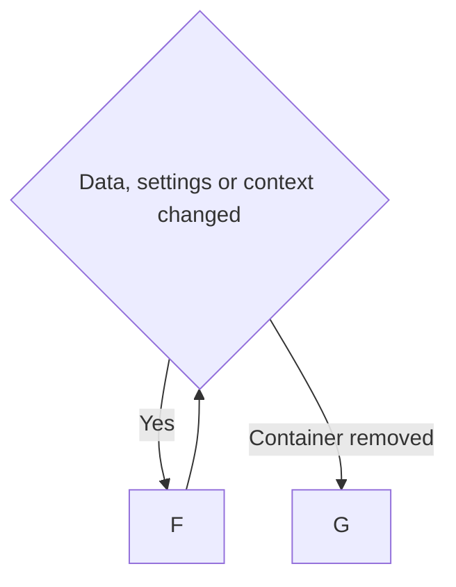

### Decision with loops

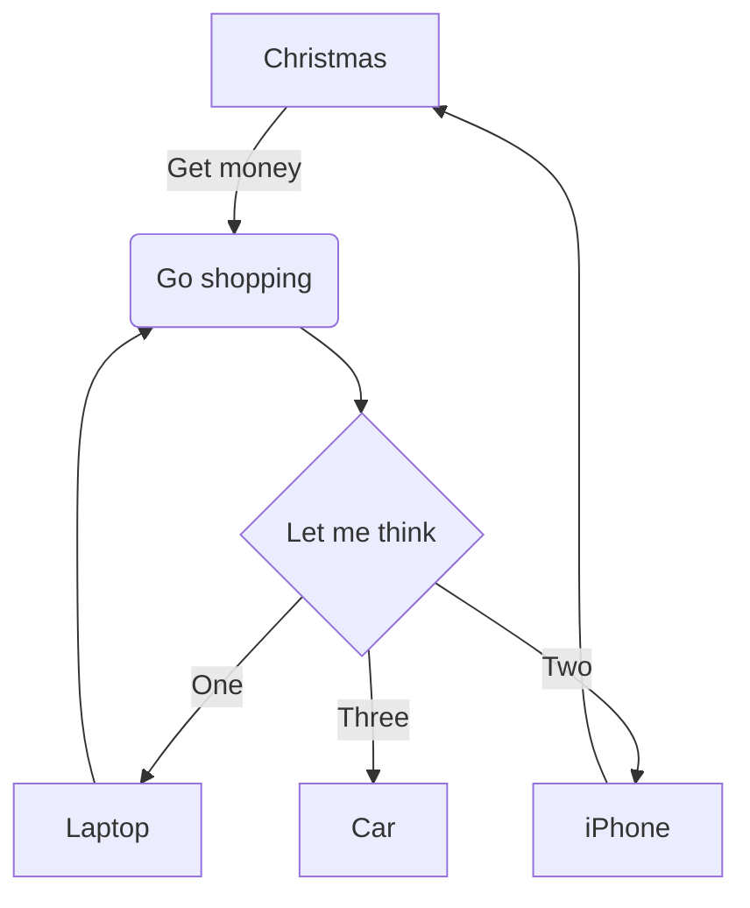

### Tree

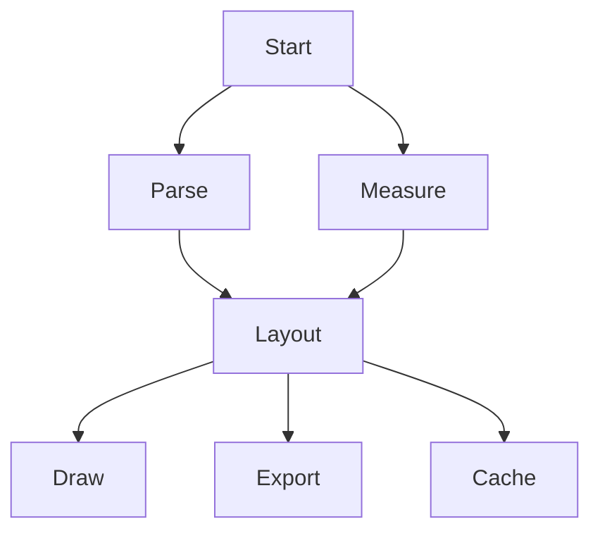

### Fan out, 3

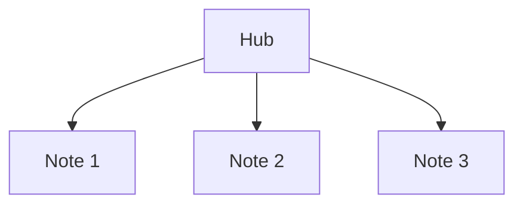

### Fan out, 7

More edges than fit at a full pitch, so they leave closer together.

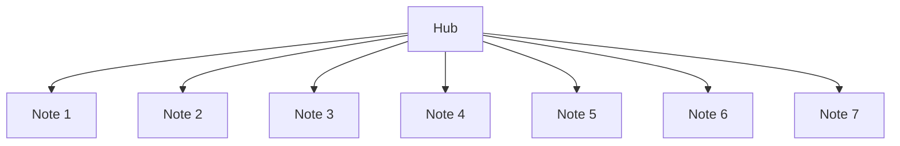

### Fan in, 3

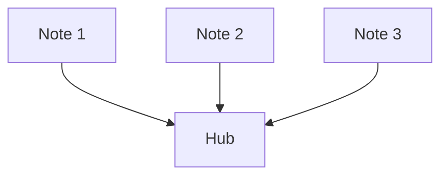

### Fan in, 7

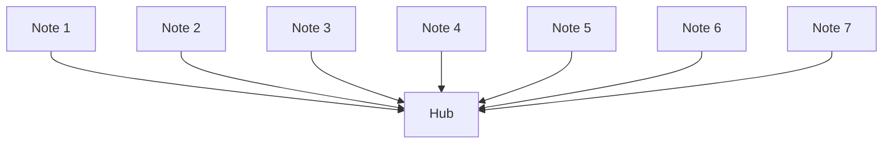

### Hub with edges both ways

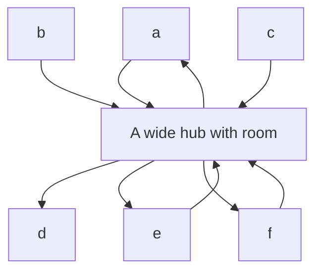

### Parallel edges

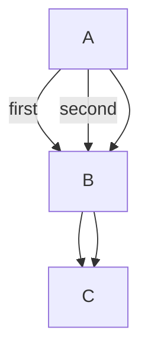

### Self-loops with other edges

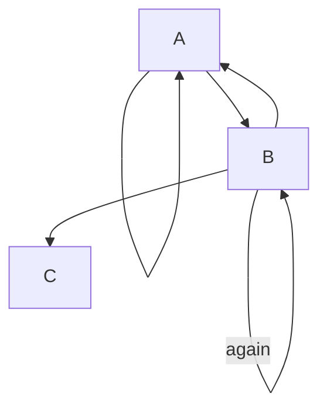

### Arrow types and line styles

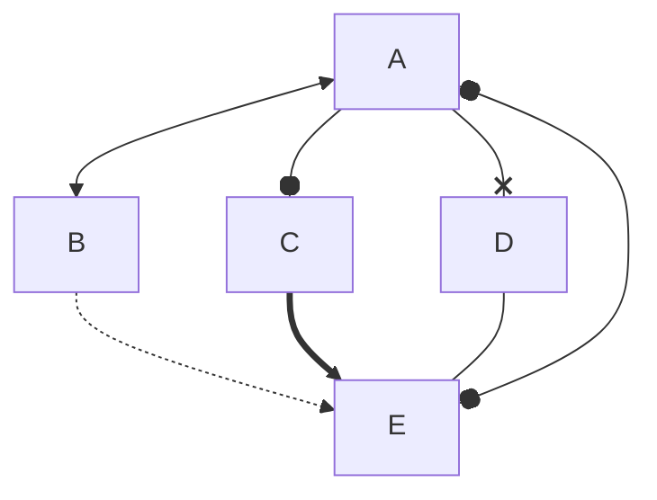

## Directions

### TD

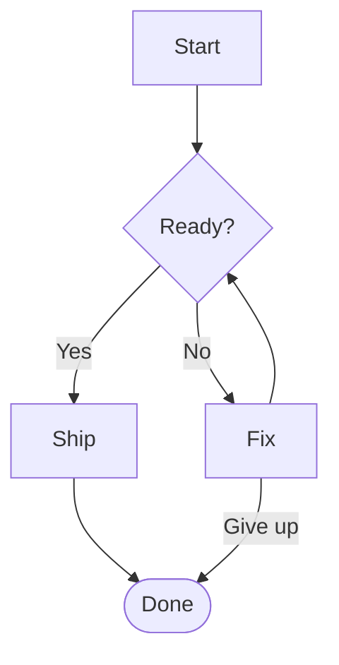

### BT

```mermaid
flowchart BT
  A[Start] --> B{Ready?}
  B -->|Yes| C[Ship]
  B -->|No| D[Fix]
  D --> B
  C --> E([Done])
  D -->|Give up| E
```

### LR

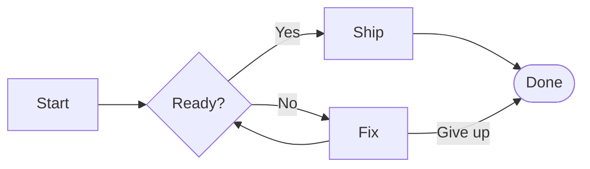

### RL

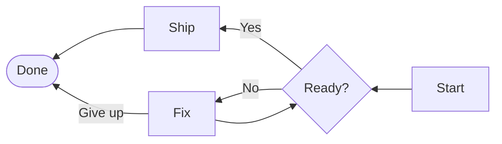

## Shapes

### Sheet 1, top to bottom

Every edge should end on the outline of its shape.

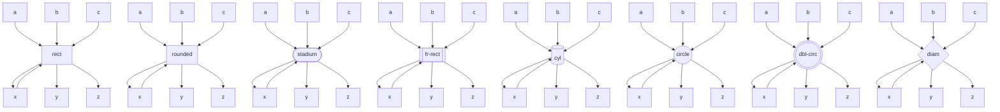

### Sheet 2, top to bottom

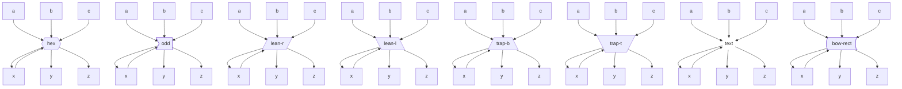

### Sheet 3, top to bottom

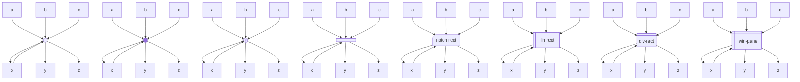

### Sheet 4, top to bottom

```mermaid
flowchart TD
  a0[a] & b0[b] & c0[c] --> n0@{ shape: notch-pent, label: "notch-pent" } --> x0[x] & y0[y] & z0[z]
  x0 --> n0
  a1[a] & b1[b] & c1[c] --> n1@{ shape: cross-circ, label: "cross-circ" } --> x1[x] & y1[y] & z1[z]
  x1 --> n1
  a2[a] & b2[b] & c2[c] --> n2@{ shape: st-rect, label: "st-rect" } --> x2[x] & y2[y] & z2[z]
  x2 --> n2
  a3[a] & b3[b] & c3[c] --> n3@{ shape: datastore, label: "datastore" } --> x3[x] & y3[y] & z3[z]
  x3 --> n3
  a4[a] & b4[b] & c4[c] --> n4@{ shape: lin-cyl, label: "lin-cyl" } --> x4[x] & y4[y] & z4[z]
  x4 --> n4
  a5[a] & b5[b] & c5[c] --> n5@{ shape: tag-rect, label: "tag-rect" } --> x5[x] & y5[y] & z5[z]
  x5 --> n5
  a6[a] & b6[b] & c6[c] --> n6@{ shape: doc, label: "doc" } --> x6[x] & y6[y] & z6[z]
  x6 --> n6
  a7[a] & b7[b] & c7[c] --> n7@{ shape: tri, label: "tri" } --> x7[x] & y7[y] & z7[z]
  x7 --> n7
```

### Sheet 5, top to bottom

```mermaid
flowchart TD
  a0[a] & b0[b] & c0[c] --> n0@{ shape: flip-tri, label: "flip-tri" } --> x0[x] & y0[y] & z0[z]
  x0 --> n0
  a1[a] & b1[b] & c1[c] --> n1@{ shape: sl-rect, label: "sl-rect" } --> x1[x] & y1[y] & z1[z]
  x1 --> n1
  a2[a] & b2[b] & c2[c] --> n2@{ shape: hourglass, label: "hourglass" } --> x2[x] & y2[y] & z2[z]
  x2 --> n2
  a3[a] & b3[b] & c3[c] --> n3@{ shape: delay, label: "delay" } --> x3[x] & y3[y] & z3[z]
  x3 --> n3
  a4[a] & b4[b] & c4[c] --> n4@{ shape: h-cyl, label: "h-cyl" } --> x4[x] & y4[y] & z4[z]
  x4 --> n4
  a5[a] & b5[b] & c5[c] --> n5@{ shape: curv-trap, label: "curv-trap" } --> x5[x] & y5[y] & z5[z]
  x5 --> n5
  a6[a] & b6[b] & c6[c] --> n6@{ shape: docs, label: "docs" } --> x6[x] & y6[y] & z6[z]
  x6 --> n6
  a7[a] & b7[b] & c7[c] --> n7@{ shape: flag, label: "flag" } --> x7[x] & y7[y] & z7[z]
  x7 --> n7
```

### Sheet 6, top to bottom

```mermaid
flowchart TD
  a0[a] & b0[b] & c0[c] --> n0@{ shape: bolt, label: "bolt" } --> x0[x] & y0[y] & z0[z]
  x0 --> n0
  a1[a] & b1[b] & c1[c] --> n1@{ shape: bang, label: "bang" } --> x1[x] & y1[y] & z1[z]
  x1 --> n1
  a2[a] & b2[b] & c2[c] --> n2@{ shape: cloud, label: "cloud" } --> x2[x] & y2[y] & z2[z]
  x2 --> n2
  a3[a] & b3[b] & c3[c] --> n3@{ shape: brace, label: "brace" } --> x3[x] & y3[y] & z3[z]
  x3 --> n3
  a4[a] & b4[b] & c4[c] --> n4@{ shape: brace-r, label: "brace-r" } --> x4[x] & y4[y] & z4[z]
  x4 --> n4
  a5[a] & b5[b] & c5[c] --> n5@{ shape: braces, label: "braces" } --> x5[x] & y5[y] & z5[z]
  x5 --> n5
  a6[a] & b6[b] & c6[c] --> n6@{ shape: tag-doc, label: "tag-doc" } --> x6[x] & y6[y] & z6[z]
  x6 --> n6
  a7[a] & b7[b] & c7[c] --> n7@{ shape: lin-doc, label: "lin-doc" } --> x7[x] & y7[y] & z7[z]
  x7 --> n7
```

### Sheet 1, left to right

```mermaid
flowchart LR
  a0[a] & b0[b] & c0[c] --> n0@{ shape: rect, label: "rect" } --> x0[x] & y0[y] & z0[z]
  x0 --> n0
  a1[a] & b1[b] & c1[c] --> n1@{ shape: rounded, label: "rounded" } --> x1[x] & y1[y] & z1[z]
  x1 --> n1
  a2[a] & b2[b] & c2[c] --> n2@{ shape: stadium, label: "stadium" } --> x2[x] & y2[y] & z2[z]
  x2 --> n2
  a3[a] & b3[b] & c3[c] --> n3@{ shape: fr-rect, label: "fr-rect" } --> x3[x] & y3[y] & z3[z]
  x3 --> n3
  a4[a] & b4[b] & c4[c] --> n4@{ shape: cyl, label: "cyl" } --> x4[x] & y4[y] & z4[z]
  x4 --> n4
  a5[a] & b5[b] & c5[c] --> n5@{ shape: circle, label: "circle" } --> x5[x] & y5[y] & z5[z]
  x5 --> n5
  a6[a] & b6[b] & c6[c] --> n6@{ shape: dbl-circ, label: "dbl-circ" } --> x6[x] & y6[y] & z6[z]
  x6 --> n6
  a7[a] & b7[b] & c7[c] --> n7@{ shape: diam, label: "diam" } --> x7[x] & y7[y] & z7[z]
  x7 --> n7
```

### Sheet 2, left to right

```mermaid
flowchart LR
  a0[a] & b0[b] & c0[c] --> n0@{ shape: hex, label: "hex" } --> x0[x] & y0[y] & z0[z]
  x0 --> n0
  a1[a] & b1[b] & c1[c] --> n1@{ shape: odd, label: "odd" } --> x1[x] & y1[y] & z1[z]
  x1 --> n1
  a2[a] & b2[b] & c2[c] --> n2@{ shape: lean-r, label: "lean-r" } --> x2[x] & y2[y] & z2[z]
  x2 --> n2
  a3[a] & b3[b] & c3[c] --> n3@{ shape: lean-l, label: "lean-l" } --> x3[x] & y3[y] & z3[z]
  x3 --> n3
  a4[a] & b4[b] & c4[c] --> n4@{ shape: trap-b, label: "trap-b" } --> x4[x] & y4[y] & z4[z]
  x4 --> n4
  a5[a] & b5[b] & c5[c] --> n5@{ shape: trap-t, label: "trap-t" } --> x5[x] & y5[y] & z5[z]
  x5 --> n5
  a6[a] & b6[b] & c6[c] --> n6@{ shape: text, label: "text" } --> x6[x] & y6[y] & z6[z]
  x6 --> n6
  a7[a] & b7[b] & c7[c] --> n7@{ shape: bow-rect, label: "bow-rect" } --> x7[x] & y7[y] & z7[z]
  x7 --> n7
```

### Sheet 3, left to right

```mermaid
flowchart LR
  a0[a] & b0[b] & c0[c] --> n0@{ shape: sm-circ, label: "sm-circ" } --> x0[x] & y0[y] & z0[z]
  x0 --> n0
  a1[a] & b1[b] & c1[c] --> n1@{ shape: f-circ, label: "f-circ" } --> x1[x] & y1[y] & z1[z]
  x1 --> n1
  a2[a] & b2[b] & c2[c] --> n2@{ shape: fr-circ, label: "fr-circ" } --> x2[x] & y2[y] & z2[z]
  x2 --> n2
  a3[a] & b3[b] & c3[c] --> n3@{ shape: fork, label: "fork" } --> x3[x] & y3[y] & z3[z]
  x3 --> n3
  a4[a] & b4[b] & c4[c] --> n4@{ shape: notch-rect, label: "notch-rect" } --> x4[x] & y4[y] & z4[z]
  x4 --> n4
  a5[a] & b5[b] & c5[c] --> n5@{ shape: lin-rect, label: "lin-rect" } --> x5[x] & y5[y] & z5[z]
  x5 --> n5
  a6[a] & b6[b] & c6[c] --> n6@{ shape: div-rect, label: "div-rect" } --> x6[x] & y6[y] & z6[z]
  x6 --> n6
  a7[a] & b7[b] & c7[c] --> n7@{ shape: win-pane, label: "win-pane" } --> x7[x] & y7[y] & z7[z]
  x7 --> n7
```

### Sheet 4, left to right

```mermaid
flowchart LR
  a0[a] & b0[b] & c0[c] --> n0@{ shape: notch-pent, label: "notch-pent" } --> x0[x] & y0[y] & z0[z]
  x0 --> n0
  a1[a] & b1[b] & c1[c] --> n1@{ shape: cross-circ, label: "cross-circ" } --> x1[x] & y1[y] & z1[z]
  x1 --> n1
  a2[a] & b2[b] & c2[c] --> n2@{ shape: st-rect, label: "st-rect" } --> x2[x] & y2[y] & z2[z]
  x2 --> n2
  a3[a] & b3[b] & c3[c] --> n3@{ shape: datastore, label: "datastore" } --> x3[x] & y3[y] & z3[z]
  x3 --> n3
  a4[a] & b4[b] & c4[c] --> n4@{ shape: lin-cyl, label: "lin-cyl" } --> x4[x] & y4[y] & z4[z]
  x4 --> n4
  a5[a] & b5[b] & c5[c] --> n5@{ shape: tag-rect, label: "tag-rect" } --> x5[x] & y5[y] & z5[z]
  x5 --> n5
  a6[a] & b6[b] & c6[c] --> n6@{ shape: doc, label: "doc" } --> x6[x] & y6[y] & z6[z]
  x6 --> n6
  a7[a] & b7[b] & c7[c] --> n7@{ shape: tri, label: "tri" } --> x7[x] & y7[y] & z7[z]
  x7 --> n7
```

### Sheet 5, left to right

```mermaid
flowchart LR
  a0[a] & b0[b] & c0[c] --> n0@{ shape: flip-tri, label: "flip-tri" } --> x0[x] & y0[y] & z0[z]
  x0 --> n0
  a1[a] & b1[b] & c1[c] --> n1@{ shape: sl-rect, label: "sl-rect" } --> x1[x] & y1[y] & z1[z]
  x1 --> n1
  a2[a] & b2[b] & c2[c] --> n2@{ shape: hourglass, label: "hourglass" } --> x2[x] & y2[y] & z2[z]
  x2 --> n2
  a3[a] & b3[b] & c3[c] --> n3@{ shape: delay, label: "delay" } --> x3[x] & y3[y] & z3[z]
  x3 --> n3
  a4[a] & b4[b] & c4[c] --> n4@{ shape: h-cyl, label: "h-cyl" } --> x4[x] & y4[y] & z4[z]
  x4 --> n4
  a5[a] & b5[b] & c5[c] --> n5@{ shape: curv-trap, label: "curv-trap" } --> x5[x] & y5[y] & z5[z]
  x5 --> n5
  a6[a] & b6[b] & c6[c] --> n6@{ shape: docs, label: "docs" } --> x6[x] & y6[y] & z6[z]
  x6 --> n6
  a7[a] & b7[b] & c7[c] --> n7@{ shape: flag, label: "flag" } --> x7[x] & y7[y] & z7[z]
  x7 --> n7
```

### Sheet 6, left to right

```mermaid
flowchart LR
  a0[a] & b0[b] & c0[c] --> n0@{ shape: bolt, label: "bolt" } --> x0[x] & y0[y] & z0[z]
  x0 --> n0
  a1[a] & b1[b] & c1[c] --> n1@{ shape: bang, label: "bang" } --> x1[x] & y1[y] & z1[z]
  x1 --> n1
  a2[a] & b2[b] & c2[c] --> n2@{ shape: cloud, label: "cloud" } --> x2[x] & y2[y] & z2[z]
  x2 --> n2
  a3[a] & b3[b] & c3[c] --> n3@{ shape: brace, label: "brace" } --> x3[x] & y3[y] & z3[z]
  x3 --> n3
  a4[a] & b4[b] & c4[c] --> n4@{ shape: brace-r, label: "brace-r" } --> x4[x] & y4[y] & z4[z]
  x4 --> n4
  a5[a] & b5[b] & c5[c] --> n5@{ shape: braces, label: "braces" } --> x5[x] & y5[y] & z5[z]
  x5 --> n5
  a6[a] & b6[b] & c6[c] --> n6@{ shape: tag-doc, label: "tag-doc" } --> x6[x] & y6[y] & z6[z]
  x6 --> n6
  a7[a] & b7[b] & c7[c] --> n7@{ shape: lin-doc, label: "lin-doc" } --> x7[x] & y7[y] & z7[z]
  x7 --> n7
```

## Subgraphs

### Edges across and onto groups

An edge that ends on a group should not land where another edge passes through its border.

```mermaid
flowchart TD
  subgraph one [Group one]
    a1 --> a2
    a1 --> a3
  end
  subgraph two [Group two]
    b1 --> b2
  end
  a2 --> b1
  a3 --> b1
  b2 --> a1
  c --> one
  c --> two
  one --> d
  two --> d
```

### Two-way between groups

```mermaid
flowchart LR
  subgraph Client
    UI[Web app]
    Cache[(Local cache)]
  end
  subgraph Services
    API[API gateway] --> Orders[Order service]
    API --> Auth[Auth service]
  end
  UI --> Cache
  UI --> API
  API --> UI
  Auth -.->|token| UI
  Orders --> DB[(Orders DB)]
```

### Nested groups

```mermaid
flowchart TD
  subgraph outer [Outer]
    subgraph inner [Inner]
      a --> b
      b --> a
    end
    c --> a
    b --> d
  end
  start --> c
  start --> a
  d --> finish
  b --> finish
  finish --> start
```

### Groups with their own direction

```mermaid
flowchart LR
  subgraph top [Runs down]
    direction TB
    t1 --> t2 --> t3
  end
  subgraph side [Runs across]
    direction LR
    s1 --> s2 --> s3
  end
  outside --> top
  outside --> s1
  t3 --> s2
  s3 --> t1
```

### Group to group, both ways

```mermaid
flowchart TD
  subgraph A [First]
    a1
    a2
  end
  subgraph B [Second]
    b1
    b2
  end
  A --> B
  B --> A
  a1 --> b1
  b2 --> a2
```

## Wide and dense

### Notes into two hubs

Long runs across the gap between two ranks.

```mermaid
flowchart TD
  a0["Flex layout"] --> MOC[_MOC]
  a1["New home page and PARA design"] --> MOC[_MOC]
  a2["2024-07-15"] --> MOC[_MOC]
  a3["2024-06-13"] --> MOC[_MOC]
  a4["2025-04-17"] --> MOC[_MOC]
  a5["Test note"] --> MOC[_MOC]
  a6["Medium draft"] --> MOC[_MOC]
  a7["Reading list"] --> MOC[_MOC]
  a8["Garden"] --> MOC[_MOC]
  a9["Inbox"] --> MOC[_MOC]
  a10["Archive"] --> MOC[_MOC]
  a11["Ideas"] --> MOC[_MOC]
  a0 --> Weekly
  a1 --> Weekly
  a2 --> Weekly
  a3 --> Weekly
  a9 --> Weekly
  a11 --> Weekly
```

### Wide graph with a repeated edge

The repeat gives every edge a rank in the middle, which should not show as a bend.

```mermaid
graph TD
  hub["Hub"]
  index["Index"]
  Plugins["Plugins"] --> hub
  Medium_draft["Medium draft"] --> hub
  Medium_draft["Medium draft"] --> hub
  Test_note["Test note"] --> hub
  2025_04_17["2025-04-17"] --> hub
  2024_06_13["2024-06-13"] --> hub
  2024_07_15["2024-07-15"] --> hub
  PARA_design["PARA design"] --> hub
  index --> Notes["Notes"]
  index --> Obsidian["Obsidian"]
  index --> Reading["Reading"]
  index --> Reading["Reading"]
  index --> Clippings["Clippings"]
  index --> Daily["Daily"]
  index --> Weekly["Weekly"]
  index --> Monthly["Monthly"]
  index --> Projects["Projects"]
  index --> Project_log["Project log"]
```

### Fan in, 30

```mermaid
flowchart TD
  n1[Note 1] --> hub[Hub]
  n2[Note 2] --> hub[Hub]
  n3[Note 3] --> hub[Hub]
  n4[Note 4] --> hub[Hub]
  n5[Note 5] --> hub[Hub]
  n6[Note 6] --> hub[Hub]
  n7[Note 7] --> hub[Hub]
  n8[Note 8] --> hub[Hub]
  n9[Note 9] --> hub[Hub]
  n10[Note 10] --> hub[Hub]
  n11[Note 11] --> hub[Hub]
  n12[Note 12] --> hub[Hub]
  n13[Note 13] --> hub[Hub]
  n14[Note 14] --> hub[Hub]
  n15[Note 15] --> hub[Hub]
  n16[Note 16] --> hub[Hub]
  n17[Note 17] --> hub[Hub]
  n18[Note 18] --> hub[Hub]
  n19[Note 19] --> hub[Hub]
  n20[Note 20] --> hub[Hub]
  n21[Note 21] --> hub[Hub]
  n22[Note 22] --> hub[Hub]
  n23[Note 23] --> hub[Hub]
  n24[Note 24] --> hub[Hub]
  n25[Note 25] --> hub[Hub]
  n26[Note 26] --> hub[Hub]
  n27[Note 27] --> hub[Hub]
  n28[Note 28] --> hub[Hub]
  n29[Note 29] --> hub[Hub]
  n30[Note 30] --> hub[Hub]
```

### Fan out, 30, left to right

```mermaid
flowchart LR
  hub[Hub] --> n1[Note 1]
  hub[Hub] --> n2[Note 2]
  hub[Hub] --> n3[Note 3]
  hub[Hub] --> n4[Note 4]
  hub[Hub] --> n5[Note 5]
  hub[Hub] --> n6[Note 6]
  hub[Hub] --> n7[Note 7]
  hub[Hub] --> n8[Note 8]
  hub[Hub] --> n9[Note 9]
  hub[Hub] --> n10[Note 10]
  hub[Hub] --> n11[Note 11]
  hub[Hub] --> n12[Note 12]
  hub[Hub] --> n13[Note 13]
  hub[Hub] --> n14[Note 14]
  hub[Hub] --> n15[Note 15]
  hub[Hub] --> n16[Note 16]
  hub[Hub] --> n17[Note 17]
  hub[Hub] --> n18[Note 18]
  hub[Hub] --> n19[Note 19]
  hub[Hub] --> n20[Note 20]
  hub[Hub] --> n21[Note 21]
  hub[Hub] --> n22[Note 22]
  hub[Hub] --> n23[Note 23]
  hub[Hub] --> n24[Note 24]
  hub[Hub] --> n25[Note 25]
  hub[Hub] --> n26[Note 26]
  hub[Hub] --> n27[Note 27]
  hub[Hub] --> n28[Note 28]
  hub[Hub] --> n29[Note 29]
  hub[Hub] --> n30[Note 30]
```

### Two dense ranks

```mermaid
flowchart TD
  top1 --> low1
  top1 --> low3
  top1 --> low4
  top1 --> low6
  top2 --> low1
  top2 --> low3
  top2 --> low4
  top2 --> low6
  top4 --> low1
  top4 --> low3
  top4 --> low4
  top4 --> low6
  top5 --> low1
  top5 --> low3
  top5 --> low4
  top5 --> low6
```

### Chain with edges that skip ranks

```mermaid
flowchart TD
  s1[Step 1] --> s2[Step 2]
  s2[Step 2] --> s3[Step 3]
  s3[Step 3] --> s4[Step 4]
  s4[Step 4] --> s5[Step 5]
  s5[Step 5] --> s6[Step 6]
  s6[Step 6] --> s7[Step 7]
  s7[Step 7] --> s8[Step 8]
  s1 --> s4
  s1 --> s8
  s2 --> s6
  s3 --> s7
  s7 --> s2
  s8 --> s1
```

### Short nodes beside a tall one

```mermaid
flowchart TD
  a[Short] --> far[Far away]
  b["A tall node<br>with four<br>lines of<br>text"] --> near
  c[Short] --> near
  d[One] --> near
  e[Two] --> near
  f[Three] --> near
  g[Four] --> far
  a --> near
```

### Wide rank over a narrow one

```mermaid
flowchart TD
  root --> a[A fairly long label here] & b[Another long label] & c[Third long label] & d[Fourth long label] & e[Fifth long label]
  a & e --> x
  b & d --> y
  a --> y
  e --> y
  c --> x
```

## Labels

### Labels on a fan

```mermaid
flowchart TD
  A{Which way?} -->|The first and longest of the answers| B
  A -->|Second| C
  A -->|A third answer| D
  A -->|Fourth| E
  B -->|Back| A
```

### Labels on a two-way pair

```mermaid
flowchart LR
  A[Client] -->|request| B[Server]
  B -->|response| A
  B -->|query| C[(Database)]
  C -->|rows| B
```

### Tall and wide nodes

```mermaid
flowchart TD
  A["One line"] --> B["A node whose label is long enough that it wraps onto several lines of text"]
  A --> C["Short"]
  B --> D["Line one<br>line two<br>line three<br>line four"]
  C --> D
  D --> A
  D --> B
```

## Right angles

### Decision with a way back

With `curve: step`, each edge runs on a track of its own and turns in rounded corners.

```mermaid
---
config:
  flowchart:
    curve: step
---
flowchart TD
  A[Start] --> B[Parse]
  A --> C[Measure]
  A --> D[Theme]
  B --> E{Fits?}
  C --> E
  D --> E
  E -->|Yes| F[Draw]
  E -->|No| A
```

### Tall and wide nodes

```mermaid
---
config:
  flowchart:
    curve: step
---
flowchart TD
  A["One line"] --> B["A node whose label is long enough that it wraps onto several lines of text"]
  A --> C["Short"]
  B --> D["Line one<br>line two<br>line three<br>line four"]
  C --> D
  D --> A
  D --> B
```

### Decision with loops

```mermaid
---
config:
  flowchart:
    curve: step
---
flowchart TD
  A[Christmas] -->|Get money| B(Go shopping)
  B --> C{Let me think}
  C -->|One| D[Laptop]
  C -->|Two| E[iPhone]
  C -->|Three| F[Car]
  D --> B
  E --> A
```

### Left to right

```mermaid
---
config:
  flowchart:
    curve: step
---
flowchart LR
  A[Start] --> B{Ready?}
  B -->|Yes| C[Ship]
  B -->|No| D[Fix]
  D --> B
  C --> E([Done])
  D -->|Give up| E
```

### Hub with edges both ways

```mermaid
---
config:
  flowchart:
    curve: step
---
flowchart TD
  a --> hub[A wide hub with room]
  b --> hub
  hub --> a
  c --> hub
  hub --> d
  hub --> e
  e --> hub
  f --> hub
  hub --> f
```

### Edges across and onto groups

```mermaid
---
config:
  flowchart:
    curve: step
---
flowchart TD
  subgraph one [Group one]
    a1 --> a2
    a1 --> a3
  end
  subgraph two [Group two]
    b1 --> b2
  end
  a2 --> b1
  a3 --> b1
  b2 --> a1
  c --> one
  c --> two
  one --> d
  two --> d
```

### Notes into two hubs

```mermaid
---
config:
  flowchart:
    curve: step
---
flowchart TD
  a0["Flex layout"] --> MOC[_MOC]
  a1["New home page and PARA design"] --> MOC[_MOC]
  a2["2024-07-15"] --> MOC[_MOC]
  a3["2024-06-13"] --> MOC[_MOC]
  a4["2025-04-17"] --> MOC[_MOC]
  a5["Test note"] --> MOC[_MOC]
  a6["Medium draft"] --> MOC[_MOC]
  a7["Reading list"] --> MOC[_MOC]
  a8["Garden"] --> MOC[_MOC]
  a9["Inbox"] --> MOC[_MOC]
  a10["Archive"] --> MOC[_MOC]
  a11["Ideas"] --> MOC[_MOC]
  a0 --> Weekly
  a1 --> Weekly
  a2 --> Weekly
  a3 --> Weekly
  a9 --> Weekly
  a11 --> Weekly
```

### Wide graph with a repeated edge

```mermaid
---
config:
  flowchart:
    curve: step
---
graph TD
  hub["Hub"]
  index["Index"]
  Plugins["Plugins"] --> hub
  Medium_draft["Medium draft"] --> hub
  Medium_draft["Medium draft"] --> hub
  Test_note["Test note"] --> hub
  2025_04_17["2025-04-17"] --> hub
  2024_06_13["2024-06-13"] --> hub
  2024_07_15["2024-07-15"] --> hub
  PARA_design["PARA design"] --> hub
  index --> Notes["Notes"]
  index --> Obsidian["Obsidian"]
  index --> Reading["Reading"]
  index --> Reading["Reading"]
  index --> Clippings["Clippings"]
  index --> Daily["Daily"]
  index --> Weekly["Weekly"]
  index --> Monthly["Monthly"]
  index --> Projects["Projects"]
  index --> Project_log["Project log"]
```

### Two dense ranks

```mermaid
---
config:
  flowchart:
    curve: step
---
flowchart TD
  top1 --> low1
  top1 --> low3
  top1 --> low4
  top1 --> low6
  top2 --> low1
  top2 --> low3
  top2 --> low4
  top2 --> low6
  top4 --> low1
  top4 --> low3
  top4 --> low4
  top4 --> low6
  top5 --> low1
  top5 --> low3
  top5 --> low4
  top5 --> low6
```

### Chain with edges that skip ranks

```mermaid
---
config:
  flowchart:
    curve: step
---
flowchart TD
  s1[Step 1] --> s2[Step 2]
  s2[Step 2] --> s3[Step 3]
  s3[Step 3] --> s4[Step 4]
  s4[Step 4] --> s5[Step 5]
  s5[Step 5] --> s6[Step 6]
  s6[Step 6] --> s7[Step 7]
  s7[Step 7] --> s8[Step 8]
  s1 --> s4
  s1 --> s8
  s2 --> s6
  s3 --> s7
  s7 --> s2
  s8 --> s1
```

### Fan in, 30

```mermaid
---
config:
  flowchart:
    curve: step
---
flowchart TD
  n1[Note 1] --> hub[Hub]
  n2[Note 2] --> hub[Hub]
  n3[Note 3] --> hub[Hub]
  n4[Note 4] --> hub[Hub]
  n5[Note 5] --> hub[Hub]
  n6[Note 6] --> hub[Hub]
  n7[Note 7] --> hub[Hub]
  n8[Note 8] --> hub[Hub]
  n9[Note 9] --> hub[Hub]
  n10[Note 10] --> hub[Hub]
  n11[Note 11] --> hub[Hub]
  n12[Note 12] --> hub[Hub]
  n13[Note 13] --> hub[Hub]
  n14[Note 14] --> hub[Hub]
  n15[Note 15] --> hub[Hub]
  n16[Note 16] --> hub[Hub]
  n17[Note 17] --> hub[Hub]
  n18[Note 18] --> hub[Hub]
  n19[Note 19] --> hub[Hub]
  n20[Note 20] --> hub[Hub]
  n21[Note 21] --> hub[Hub]
  n22[Note 22] --> hub[Hub]
  n23[Note 23] --> hub[Hub]
  n24[Note 24] --> hub[Hub]
  n25[Note 25] --> hub[Hub]
  n26[Note 26] --> hub[Hub]
  n27[Note 27] --> hub[Hub]
  n28[Note 28] --> hub[Hub]
  n29[Note 29] --> hub[Hub]
  n30[Note 30] --> hub[Hub]
```

## Curves

### basis

```mermaid
---
config:
  flowchart:
    curve: basis
---
flowchart TD
  A[Start] --> B[Parse]
  A --> C[Measure]
  A --> D[Theme]
  B --> E{Fits?}
  C --> E
  D --> E
  E -->|Yes| F[Draw]
  E -->|No| A
```

### linear

```mermaid
---
config:
  flowchart:
    curve: linear
---
flowchart TD
  A[Start] --> B[Parse]
  A --> C[Measure]
  A --> D[Theme]
  B --> E{Fits?}
  C --> E
  D --> E
  E -->|Yes| F[Draw]
  E -->|No| A
```

### step

```mermaid
---
config:
  flowchart:
    curve: step
---
flowchart TD
  A[Start] --> B[Parse]
  A --> C[Measure]
  A --> D[Theme]
  B --> E{Fits?}
  C --> E
  D --> E
  E -->|Yes| F[Draw]
  E -->|No| A
```

### stepBefore

```mermaid
---
config:
  flowchart:
    curve: stepBefore
---
flowchart TD
  A[Start] --> B[Parse]
  A --> C[Measure]
  A --> D[Theme]
  B --> E{Fits?}
  C --> E
  D --> E
  E -->|Yes| F[Draw]
  E -->|No| A
```

### stepAfter

```mermaid
---
config:
  flowchart:
    curve: stepAfter
---
flowchart TD
  A[Start] --> B[Parse]
  A --> C[Measure]
  A --> D[Theme]
  B --> E{Fits?}
  C --> E
  D --> E
  E -->|Yes| F[Draw]
  E -->|No| A
```

## Documentation examples

```mermaid
---
title: Node
---
flowchart LR
    id
```

```mermaid
---
title: Node with text
---
flowchart LR
    id1[This is the text in the box]
```

```mermaid
flowchart LR
    id["This ❤ Unicode"]
```

```mermaid
---
config:
  htmlLabels: false
---
flowchart LR
    markdown["`This **is** _Markdown_`"]
    newLines["`Line1
    Line 2
    Line 3`"]
    markdown --> newLines
```

```mermaid
flowchart TD
    Start --> Stop
```

```mermaid
flowchart LR
    Start --> Stop
```

```mermaid
flowchart LR
  subgraph Client
    UI[Web app]
    Cache[(Local cache)]
  end
  subgraph Services
    API[API gateway]
    Auth[Auth service]
    Orders[Order service]
  end
  subgraph Storage
    DB[(Orders DB)]
  end
  UI --> API
  UI --> Cache
  API --> Auth
  API --> Orders
  Orders --> DB
  Auth -. token .-> UI
```

```mermaid
---
config:
  theme: default
  look: classic
  layout: dagre
---
flowchart LR
  subgraph Client
    UI[Web app]
    Cache[(Local cache)]
  end
  subgraph Services
    API[API gateway]
    Auth[Auth service]
    Orders[Order service]
  end
  subgraph Storage
    DB[(Orders DB)]
  end
  UI --> API
  UI --> Cache
  API --> Auth
  API --> Orders
  Orders --> DB
  Auth -. token .-> UI
```

```mermaid
flowchart LR
    id1(This is the text in the box)
```

```mermaid
flowchart LR
    id1([This is the text in the box])
```

```mermaid
flowchart LR
    id1[[This is the text in the box]]
```

```mermaid
flowchart LR
    id1[(Database)]
```

```mermaid
flowchart LR
    id1((This is the text in the circle))
```

```mermaid
flowchart LR
    id1>This is the text in the box]
```

```mermaid
flowchart LR
    id1{This is the text in the box}
```

```mermaid
flowchart LR
    id1{{This is the text in the box}}
```

```mermaid
flowchart TD
    id1[/This is the text in the box/]
```

```mermaid
flowchart TD
    id1[\This is the text in the box\]
```

```mermaid
flowchart TD
    A[/Christmas\]
```

```mermaid
flowchart TD
    B[\Go shopping/]
```

```mermaid
flowchart TD
    id1(((This is the text in the circle)))
```

```mermaid
flowchart RL
    A@{ shape: manual-file, label: "File Handling"}
    B@{ shape: manual-input, label: "User Input"}
    C@{ shape: docs, label: "Multiple Documents"}
    D@{ shape: procs, label: "Process Automation"}
    E@{ shape: paper-tape, label: "Paper Records"}
```

```mermaid
flowchart TD
    A@{ shape: rect, label: "This is a process" }
```

```mermaid
flowchart TD
    A@{ shape: rounded, label: "This is an event" }
```

```mermaid
flowchart TD
    A@{ shape: stadium, label: "Terminal point" }
```

```mermaid
flowchart TD
    A@{ shape: subproc, label: "This is a subprocess" }
```

```mermaid
flowchart TD
    A@{ shape: cyl, label: "Database" }
```

```mermaid
flowchart TD
    A@{ shape: circle, label: "Start" }
```

```mermaid
flowchart TD
    A@{ shape: odd, label: "Odd shape" }
```

```mermaid
flowchart TD
    A@{ shape: diamond, label: "Decision" }
```

```mermaid
flowchart TD
    A@{ shape: hex, label: "Prepare conditional" }
```

```mermaid
flowchart TD
    A@{ shape: lean-r, label: "Input/Output" }
```

```mermaid
flowchart TD
    A@{ shape: lean-l, label: "Output/Input" }
```

```mermaid
flowchart TD
    A@{ shape: datastore, label: "Datastore" }
```

```mermaid
flowchart TD
    A@{ shape: trap-b, label: "Priority action" }
```

```mermaid
flowchart TD
    A@{ shape: trap-t, label: "Manual operation" }
```

```mermaid
flowchart TD
    A@{ shape: dbl-circ, label: "Stop" }
```

```mermaid
flowchart TD
    A@{ shape: text, label: "This is a text block" }
```

```mermaid
flowchart TD
    A@{ shape: notch-rect, label: "Card" }
```

```mermaid
flowchart TD
    A@{ shape: lin-rect, label: "Lined process" }
```

```mermaid
flowchart TD
    A@{ shape: sm-circ, label: "Small start" }
```

```mermaid
flowchart TD
    A@{ shape: framed-circle, label: "Stop" }
```

```mermaid
flowchart TD
    A@{ shape: fork, label: "Fork or Join" }
```

```mermaid
flowchart TD
    A@{ shape: hourglass, label: "Collate" }
```

```mermaid
flowchart TD
    A@{ shape: comment, label: "Comment" }
```

```mermaid
flowchart TD
    A@{ shape: brace-r, label: "Comment" }
```

```mermaid
flowchart TD
    A@{ shape: braces, label: "Comment" }
```

```mermaid
flowchart TD
    A@{ shape: bolt, label: "Communication link" }
```

```mermaid
flowchart TD
    A@{ shape: doc, label: "Document" }
```

```mermaid
flowchart TD
    A@{ shape: delay, label: "Delay" }
```

```mermaid
flowchart TD
    A@{ shape: das, label: "Direct access storage" }
```

```mermaid
flowchart TD
    A@{ shape: lin-cyl, label: "Disk storage" }
```

```mermaid
flowchart TD
    A@{ shape: curv-trap, label: "Display" }
```

```mermaid
flowchart TD
    A@{ shape: div-rect, label: "Divided process" }
```

```mermaid
flowchart TD
    A@{ shape: tri, label: "Extract" }
```

```mermaid
flowchart TD
    A@{ shape: win-pane, label: "Internal storage" }
```

```mermaid
flowchart TD
    A@{ shape: f-circ, label: "Junction" }
```

```mermaid
flowchart TD
    A@{ shape: lin-doc, label: "Lined document" }
```

```mermaid
flowchart TD
    A@{ shape: notch-pent, label: "Loop limit" }
```

```mermaid
flowchart TD
    A@{ shape: flip-tri, label: "Manual file" }
```

```mermaid
flowchart TD
    A@{ shape: sl-rect, label: "Manual input" }
```

```mermaid
flowchart TD
    A@{ shape: docs, label: "Multiple documents" }
```

```mermaid
flowchart TD
    A@{ shape: processes, label: "Multiple processes" }
```

```mermaid
flowchart TD
    A@{ shape: flag, label: "Paper tape" }
```

```mermaid
flowchart TD
    A@{ shape: bow-rect, label: "Stored data" }
```

```mermaid
flowchart TD
    A@{ shape: cross-circ, label: "Summary" }
```

```mermaid
flowchart TD
    A@{ shape: tag-doc, label: "Tagged document" }
```

```mermaid
flowchart TD
    A@{ shape: tag-rect, label: "Tagged process" }
```

```mermaid
flowchart TD
    A@{ icon: "fa:user", form: "square", label: "User Icon", pos: "t", h: 60 }
```

```mermaid
flowchart TD
  %% My image with a constrained aspect ratio
  A@{ img: "https://mermaid.js.org/favicon.svg", label: "My example image label", pos: "t", h: 60, constraint: "on" }
```

```mermaid
flowchart LR
    A-->B
```

```mermaid
flowchart LR
    A --- B
```

```mermaid
flowchart LR
    A-- This is the text! ---B
```

```mermaid
flowchart LR
    A---|This is the text|B
```

```mermaid
flowchart LR
    A-->|text|B
```

```mermaid
flowchart LR
    A-- text -->B
```

```mermaid
flowchart LR
   A-.->B;
```

```mermaid
flowchart LR
   A-. text .-> B
```

```mermaid
flowchart LR
   A ==> B
```

```mermaid
flowchart LR
   A == text ==> B
```

```mermaid
flowchart LR
    A ~~~ B
```

```mermaid
flowchart LR
   A -- text --> B -- text2 --> C
```

```mermaid
flowchart LR
   a --> b & c--> d
```

```mermaid
flowchart TB
    A & B--> C & D
```

```mermaid
flowchart TB
    A --> C
    A --> D
    B --> C
    B --> D
```

```mermaid
flowchart LR
  A e1@--> B
```

```mermaid
flowchart LR
  A e1@==> B
  e1@{ animate: true }
```

```mermaid
flowchart LR
  A e1@--> B
  e1@{ animation: fast }
```

```mermaid
flowchart LR
  A e1@--> B
  classDef animate stroke-dasharray: 9,5,stroke-dashoffset: 900,animation: dash 25s linear infinite;
  class e1 animate
```

```mermaid
flowchart LR
    A --o B
```

```mermaid
flowchart LR
    A --x B
```

```mermaid
flowchart LR
    A o--o B
    B <--> C
    C x--x D
```

```mermaid
flowchart TD
    A[Start] --> B{Is it?}
    B -->|Yes| C[OK]
    C --> D[Rethink]
    D --> B
    B ---->|No| E[End]
```

```mermaid
flowchart TD
    A[Start] --> B{Is it?}
    B -- Yes --> C[OK]
    C --> D[Rethink]
    D --> B
    B -- No ----> E[End]
```

```mermaid
flowchart LR
    id1["This is the (text) in the box"]
```

```mermaid
    flowchart LR
        A["A double quote:#quot;"] --> B["A dec char:#9829;"]
```

```mermaid
flowchart TB
    c1-->a2
    subgraph one
    a1-->a2
    end
    subgraph two
    b1-->b2
    end
    subgraph three
    c1-->c2
    end
```

```mermaid
flowchart TB
    c1-->a2
    subgraph ide1 [one]
    a1-->a2
    end
```

```mermaid
flowchart TB
    c1-->a2
    subgraph one
    a1-->a2
    end
    subgraph two
    b1-->b2
    end
    subgraph three
    c1-->c2
    end
    one --> two
    three --> two
    two --> c2
```

```mermaid
flowchart LR
  subgraph TOP
    direction TB
    subgraph B1
        direction RL
        i1 -->f1
    end
    subgraph B2
        direction BT
        i2 -->f2
    end
  end
  A --> TOP --> B
  B1 --> B2
```

```mermaid
flowchart LR
    subgraph subgraph1
        direction TB
        top1[top] --> bottom1[bottom]
    end
    subgraph subgraph2
        direction TB
        top2[top] --> bottom2[bottom]
    end
    %% ^ These subgraphs are identical, except for the links to them:

    %% Link *to* subgraph1: subgraph1 direction is maintained
    outside --> subgraph1
    %% Link *within* subgraph2:
    %% subgraph2 inherits the direction of the top-level graph (LR)
    outside ---> top2
```

```mermaid
flowchart TD
    Start --> one
    subgraph one [My Group]
        A --> B
        B --> C
    end
    one --> End
    one@{ view: collapsed }
```

```mermaid
---
config:
  htmlLabels: false
---
flowchart LR
subgraph "One"
  a("`The **cat**
  in the hat`") -- "edge label" --> b{{"`The **dog** in the hog`"}}
end
subgraph "`**Two**`"
  c("`The **cat**
  in the hat`") -- "`Bold **edge label**`" --> d("The dog in the hog")
end
```

```mermaid
flowchart LR
    A-->B
    B-->C
    C-->D
    click A callback "Tooltip for a callback"
    click B "https://www.github.com" "This is a tooltip for a link"
    click C call callback() "Tooltip for a callback"
    click D href "https://www.github.com" "This is a tooltip for a link"
```

```mermaid
flowchart LR
    A-->B
    B-->C
    C-->D
    D-->E
    click A "https://www.github.com" _blank
    click B "https://www.github.com" "Open this in a new tab" _blank
    click C href "https://www.github.com" _blank
    click D href "https://www.github.com" "Open this in a new tab" _blank
```

```mermaid
flowchart LR
%% this is a comment A -- text --> B{node}
   A -- text --> B -- text2 --> C
```

```mermaid
flowchart LR
    A e1@==> B
    A e2@--> C
    e1@{ curve: linear }
    e2@{ curve: natural }
```

```mermaid
flowchart LR
    id1(Start)-->id2(Stop)
    style id1 fill:#f9f,stroke:#333,stroke-width:4px
    style id2 fill:#bbf,stroke:#f66,stroke-width:2px,color:#fff,stroke-dasharray: 5 5
```

```mermaid
flowchart LR
    A:::someclass --> B
    classDef someclass fill:#f96
```

```mermaid
flowchart LR
    A:::foo & B:::bar --> C:::foobar
    classDef foo stroke:#f00
    classDef bar stroke:#0f0
    classDef foobar stroke:#00f
```

```mermaid
flowchart LR
    A:::myStyle --> B
    classDef myStyle fill:#ff0000,stroke:#ffff00,stroke-width:4px
```

```mermaid
flowchart TD
    B["fa:fa-twitter for peace"]
    B-->C[fa:fa-ban forbidden]
    B-->D(fa:fa-spinner)
    B-->E(A fa:fa-camera-retro perhaps?)
```

```mermaid
flowchart TD
    B["fa:fa-twitter for peace"]
    B-->C["fab:fa-truck-bold a custom icon"]
```

```mermaid
flowchart LR
    A[Hard edge] -->|Link text| B(Round edge)
    B --> C{Decision}
    C -->|One| D[Result one]
    C -->|Two| E[Result two]
```
