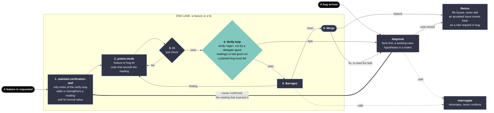

# Design: verify and diagnose

This page explains the design. [plan.md](plan.md) holds the build phases. [sources/](sources/) holds the inputs of both design rounds, listed under [How the design came about](#how-the-design-came-about).

The ideas come from Cindy Sridharan, [How to effectively debug when you no longer understand the code](https://copyconstruct.medium.com/how-to-effectively-debug-when-you-no-longer-understand-the-code-bd3dcb2c5f7b) (2026-10-10). Every skill built from this design restates her ideas in our own words and credits her with that link. No skill quotes her prose.

## The problem

Agents debug badly in predictable ways. They read code first and tell a story about what the code can do, not what it did. They take the first plausible cause for the cause. They skip the control, so they cannot tell signal from noise. They accept a repro because the symptom matches. They count a second agent's agreement as proof. In all three of the post's bugs, the agent was able to find the cause and did not, until a human supplied a control, a constraint, or a demand for citations.

Pascal's skills already hold pieces of the fix, scattered across six places with no shared vocabulary: poteto-mode's `bug-fix`, `runtime-forensics`, `trace-forensics`, and `perf-issue` playbooks, its `fix-root-causes` principle, and andy-mode's `qa` diagnosis loop. Two existing rules contradict the post outright. poteto-mode's `bug-fix` playbook seeds hypotheses by reading code with `how`, and `interrogate` treats reviewer agreement as evidence.

Pascal named two goals:

1. **Build time.** Each feature, or group of features, adds to the verify loop, so it is easy to test and to trace back
2. **Run time.** A bug arrives from production. Gather every signal from it, then apply the method

## The one idea the system rests on

**Facts constrain hypotheses, and a control turns facts into signals.**

A fact is an observation a tool or a report made, saved with its source. The agent appends facts from saved artifacts or quoted reports, cites their sources, and never invents or edits facts. A hypothesis is anything the agent derives. A hypothesis survives only while no fact contradicts it.

The same comparison serves both goals. When a bug arrives, `diagnose` compares the failing case with a control to find the reading that differs. In the verify loop, a new build is compared with the last good run to confirm that no reading differs except the intended ones. A passing verify-loop run is a diagnosis that found no signal.

So the readings a feature records at build time are the facts a future diagnosis starts from. And a closed case hands the reading that exposed its bug to the verify loop, which checks it on every run from then on. That cycle is what makes the system accretive.

## The workflow



Read it from the two doors on the left. Each skill appears once, and the verify loop has one writer. [sources/workflow-v4.mmd](sources/workflow-v4.mmd) is the source Pascal approved.

### The lane

A feature and a fix take the same six steps:

1. **maintain-verification-skill** writes the feature's readings, their normal values, and the bug the check must catch, through its focused pass in [The verify loop](#the-verify-loop)
2. **poteto-mode** `feature` or `bug-fix` writes the change, including the code that records each reading
3. **CI** runs `just check` first, because it is cheap. A failure returns to step 2
4. **The verify loop** runs in a delegate agent: a T3 child task the caller starts with `delegate_task`, in a fresh context. It compares each reading with the last good run. The planted bug must fail the first run of a new check. For a fix, the unfixed code is the planted bug, so the run shows the reading that exposed the bug failing on the unfixed code and passing on the fix, on the agreed test surface. With repro parity, that is the fix's pre-merge proof. A failure goes to `diagnose`
5. **Barrages** review the stack and call `interrogate`. A finding returns to step 2
6. **Merge.** A fix merges on its pre-merge proof. The field re-read after merge, `diagnose` step 9, earns the `fixed` claim

After a barrage fix, rerun only the features the fix touched. Run the whole loop once on the final head before merge. The whole loop is every feature the verify skill runs by default, and a check it marks paid or opt-in runs only when the change touches its feature.

### Where a feature and a bug meet

Nothing enters the lane until it can name the reading that will prove it. A feature request arrives knowing what working means, because Pascal agreed to it. A bug arrives knowing only that something does not work. `diagnose` produces what the feature request already had: one reading and its normal value. From there both are the same job.

- A confirmed cause enters step 1 carrying the reading that exposed it
- Every verify-loop failure goes to `diagnose`. Its quick path settles an obvious cause with one probe
- A merged fix returns to `diagnose` for the field re-read. Then the case closes and goes to the retros. A merged feature goes to the retros directly

A bug enters and leaves through `diagnose`, because it was seen in the field and closes there. A feature closes at merge, because the verify loop already proved what was asked.

### A project's verify loop

The project's `AGENTS.md` names its verify loop, since a loop may live outside the repo it checks. `verify-video-archive` lives in the skills repo and checks the dotfiles checkout. The agent offers `create-verification-skill` the first time a project needs a verify loop. A line in the same place, "no verify loop, CI is enough", stops the offer and drops the loop parts of steps 1 and 4.

## Principles

These are the post's ideas, sharpened by the prior-art survey, written as rules an agent can act on. The skills turn each one into a step, a column, or a check. The survey's corrections to the post are marked *(survey)*.

**Stance**

1. Start from facts, not code. Code says what can happen, not what did happen. Read code only to explain a named signal
2. Play to agent strengths: reading large raw data, joining sources across layers, knowing obscure tools and formats, rerunning checks, and writing throwaway probes
3. Guard against agent weaknesses with structure, not exhortation. Required fields, citations, and checks work. Reminders do not *(survey: debiasing training failed in a controlled medical trial)*

**Facts**

4. Facts are append-only. A suspect fact is gathered again, never edited or argued away
5. An absence is a fact only with its coverage. "No logs" counts against a hypothesis only if the logs would have shown it *(survey: Heuer's expected-evidence check; the post's own auth team made this mistake)*
6. Keep the store fat and the working set thin. Raw artifacts stay on disk. The reasoning context holds one short row per fact with a pointer *(survey: more data raises confidence, not accuracy)*
7. Prefer arithmetic to narrative: counts, sizes, durations. 5 addresses against 400 settles what a paragraph cannot

**Controls and signals**

8. No control, no signal. Pick a control that differs from the failing case in the suspected factor only, and write why it is not broken the same way
9. A louder sad path that fails differently is often the cheapest good control
10. A signal is any reading that differs between the failing case and the control, in either direction. A reply the control receives and the failing case never gets is a signal *(survey: the post defines one direction only, and its hang was decided by the other)*
11. Measure the noise floor before calling a difference a signal: read two controls when readings vary *(survey: Diffy's A/A run)*
12. A signal is strong when few hypotheses explain it, ideally one. Service aggregates such as P99 are detectors, not locators

**Hypotheses**

13. Every hypothesis cites the fact it starts from and states the prediction that would kill it
14. Keep a "none of these" reservation. One surviving row does not prove the list was complete, so every claim holds only among the hypotheses listed *(survey)*
15. Before each probe meant to tell hypotheses apart, write what each live hypothesis predicts. Skip it when the predictions all agree *(survey: Platt's strong inference)*
16. One cited contradicting fact eliminates a hypothesis. Lack of support does not
17. When no row survives, repair the set before inventing: reverify facts, split coarse hypotheses, merge per-instance ones, combine complementary ones, and only then draw a new one from existing facts
18. When every signal is weak or the repairs fail, gather one layer down instead of guessing. Stop at the strongest signal, not the deepest
19. A combination is valid only when each member is needed to explain some fact. In an incident, the loop that sustains the failure matters more than the trigger *(survey: Bronson et al.)*
20. When failing instances disagree, they may be separate bugs. Cluster them and run one matrix per cluster *(survey)*

**Repros, review, and claims**

21. A repro is a hypothesis. Keep it only if it shows the report's strongest signal
22. Adversarial review eliminates. It never confirms, because no reviewer can see a missing fact. Give the reviewer facts, not the story, and use another model family
23. After a retraction, generate the next hypotheses in a fresh context from the case file alone *(survey: agents that take a wrong turn rarely recover in the same conversation)*
24. State the claim level: consistent, confirmed, or fixed. Confirmed needs a test that no other live hypothesis passes. Fixed needs, after merge and where the bug was seen, the reading that exposed it back at the control's value, the reported symptom gone, and no residual failure

**The verify loop and accretion**

25. Choose a feature's readings and their normal values before writing its code, and record them by default at the shallowest layer
26. A check that never failed proves nothing. The planted bug must fail a new check's first run
27. Every human intervention is a gap. The retros file each one as an issue for a reading, a probe, a check, or an eval, so the next case does not need it. A recurring gap becomes structure, never a prose reminder
28. People make the accountable calls. They do not relay commands or paste output for the agent

## Vocabulary

One term per concept. The skills use no synonyms for these.

| Term | Meaning |
|---|---|
| case | One investigation of one reported failure, recorded in one case file |
| variable | The failing case, scoped: which hosts, users, versions, and time window |
| control | A case compared with the variable. Types: `happy` (works), `sad` (fails differently and louder), `baseline` (last good version, or the verify loop's last good run) |
| noise floor | The spread between two readings of the same control |
| fact | An observation with its source and a saved artifact. Append-only for the agent |
| field, lab | Where a fact came from: the real failing environment, or a repro or harness. A lab fact never outranks a field fact |
| fact kind | `signal` (differs between variable and control, in either direction, beyond the noise floor), `noise` (same in both), `symptom` (seen on the variable, no control reading yet), `context` (a condition such as version, flag, or scale) |
| coverage | For an absence, what the probe could have seen. An absence without coverage cannot contradict a hypothesis |
| layer, ladder | One level of a stack, and the ordered list of levels from the cheapest (the report, logs) to the deepest (kernel tables) |
| probe | A command that reads one layer and saves its output as an artifact |
| reading | A named, countable value read from the system. A feature's readings are the ones it records on every verify-loop run |
| normal value | The value a reading has on a working build, taken from config where possible, otherwise from the last good run |
| invariant | A reading whose normal value is zero violations, enforced loudly in code |
| detector | An outcome such as success rate or latency. It shows that something failed, not where |
| verify loop | A project's `verify-<app>` skill. It drives the real app, records each feature's readings, and compares them with the last good run |
| last good run | The last passing verify-loop run of the base branch on the same machine, pinned. A failed, incomplete, or planted run never becomes the baseline |
| planted bug | The bug a check must catch, put in on purpose. For a fix, it is the unfixed code |
| hypothesis | A derived claim of cause: mechanism, starting facts, and the prediction that would kill it. Status is `live`, `replaced` (the parent of a split or a merge), or `eliminated` |
| `H0` | The "none of these" reservation. It is never marked, never counted, and never a candidate. It limits every claim to the hypotheses listed |
| mark | One cell of the matrix. `+`: if the hypothesis is true, it produces this fact. `0`: compatible with the fact, but does not produce it alone. `x`: if the hypothesis were true, this fact could not have been observed, whatever other cause is added. Every `x` cites the fact. Blank: not judged yet |
| in scope | The facts a candidate must answer to: field facts of the variable, or of its cluster when instances were clustered, plus lab facts from repros that passed parity. Facts from a rejected repro stay in the file, out of scope |
| strength | For an in-scope signal or symptom, the number of live hypotheses marked `+`, counting a combination and its members once. Strong is 1 or 2 |
| candidate | A live hypothesis marked `+` on every in-scope signal and symptom and `x` on no in-scope fact |
| combination | Hypotheses that together are a candidate, where removing any member leaves an in-scope fact unexplained. Its marks are derived: `x` where any member has `x`, `+` where any member has `+`, `0` otherwise |
| repair tactic | One of the five moves when no candidate exists: reverify, split, merge, combine, new from facts |
| descend | Gather facts one layer down, paired with the same control |
| repro | A hypothesis of the form "this setup produces the reported failure" |
| parity | Two readings agree under a stated rule. Repro parity, fix parity, and the verify loop's comparison with the last good run use the same rules |
| reviewer | An independent read-only agent that `interrogate` launches. It may only propose an elimination or flag a defect in the facts. On a case file, the diagnosing agent appends what it proposes, with `by: reviewer` |
| fact packet | What a reviewer gets in place of a diff: facts and their artifacts, such as a case file, without the author's story |
| claim level | `consistent`: a candidate survives every in-scope fact gathered, among the hypotheses listed. `confirmed`: also passed a test no other live hypothesis passes, such as toggling the suspected cause and watching the strong signal move, or a directly observed causal chain. `fixed`: after merge, where the bug was seen, the reading that exposed it matches the control, the reported symptom is gone, and a residual check finds no other failing instance or signal. Before merge, a fix has only its pre-merge proof from lane step 4. Other outcomes: `external` (the cause is in a component Pascal does not own) and `open` (stopped, naming the next observation needed) |
| requested outcome | Set at intake: `diagnosis` (read-only questions, andy-mode `qa`, audits of a claim) or `fix` |
| intervention | Any human input that changed the course of a case |

## diagnose

`diagnose` lives at `authoring/andy-devtools/diagnose/`, `kind: "dev"`. Its description triggers on bug reports, so "prod is slow, find out why" reaches it without anyone naming it. It runs only when a bug arrives or a verify-loop run fails. A bug may arrive as someone's claimed cause, repro, or fix to audit. The claim becomes a hypothesis, because a claim can only be checked against facts and a control.

- It reads Pascal's machines through the `fleet` skill, with read-only probes and no approval needed. Each run is a fact
- It calls `interrogate` with one reviewer from another model family at three checkpoints: the control (step 2), the matrix (step 4), and the validation (step 5)
- It owns the diagnosis. The lane owns the repair, and andy-mode `qa` owns the finding record
- A fixed bug's case closes only after the field re-read in step 9

Package layout:

```
diagnose/
	SKILL.md                    steps 0 to 9, the quick path, the write rule, credit
	references/glossary.md
	references/principles.md    the list above, read when a step does not fit the case
	references/case-file.md     template, column rules, who writes what
	references/ladders.md       ladders per stack, cheap probes per layer, cautions
	references/parity.md        comparison rules, noise floor, normalization
	evals/
```

### The case file

One Markdown file per case, at `${XDG_STATE_HOME:-~/.local/state}/diagnose-cases/<repo>/<case-id>/case.md`, with raw artifacts in `artifacts/` beside it. It stays out of git, because cases hold private data and large captures. What persists in git is the reading the lane adds to the verify loop and the issues the retros file.

One file is the whole state of the investigation. An agent resuming after compaction, a session pickup, or a fresh subagent after a retraction reads `case.md` and knows where the case stands. It is also the fact packet `interrogate` reviews. Markdown tables are what agents edit well and what Pascal reads directly.

Sections, each a strict table: header (variable, report, `verify-<app>` path, ladder, current layer), Controls, Facts, Hypotheses, Judgments, Log, Interventions, Decisions, Close. [sources/design-claude.md](sources/design-claude.md) section 4.1 has a filled example from the latency bug.

Column rules that carry the method:

- **Controls** require `differs by`, `matches`, and `not broken the same way because`
- **Facts** require `kind`, `layer`, `field` or `lab`, the reading on the variable and on the control, `source` (probe, host, window, tool version), `artifact`, and `supersedes`. An absence states its coverage in the statement
- **Hypotheses** require `from` (at least one fact) and `killed if` (the prediction). `origin` records `new`, `split:`, `merge:`, `combine:`, `repro`, `human`, or `reviewer`. Combination members may carry a role: `trigger`, `sustaining`, or `vulnerability`. A split or a merge marks its parent `replaced`, so the parent stops counting toward strength
- **Judgments** are append-only. A later row for the same hypothesis and fact supersedes the earlier one and cites why, so a wrong reading of a fact can be corrected without touching the fact. Every `x` cites a fact. Elimination is derived: a hypothesis whose current judgment on a current in-scope fact is `x` is eliminated. If a fact is superseded, the eliminations it caused reopen
- **Log** records each discrimination probe with what each live hypothesis predicted before it ran, each descent with its reason, each repair tactic, and each `interrogate` pass
- **Interventions** quote every human input that changed course, with a category. The retros read them

Who writes what:

| Part | Agent | Reviewer | Pascal |
|---|---|---|---|
| Facts | Appends rows for saved artifacts or quoted reports. Never edits | Proposes `reverify` log rows for gathering defects | Appends observations, retires a fact with a reason |
| Hypotheses | Adds with `from` and `killed if` | Reports facts no hypothesis explains | Adds as `by: human`, judged like any other |
| Judgments | Writes with a reason. Corrects by appending a superseding row | Proposes `x` rows citing a fact | Appends `x` rows citing a fact |
| Decisions | Writes options and a recommended default | None | Chooses |

The reviewer writes nothing. The diagnosing agent appends each row it proposes, with `by: reviewer`.

`case.py check` would lint the tables, refuse edits to fact rows, render the matrix with strength per signal, and print the next step as one JSON line under the [script output rule](../../../references/script-output.md). It ships only if Phase 1 runs show case-file bookkeeping errors. [sources/design-claude.md](sources/design-claude.md) section 4.3 has its next-step table.

### The steps

Each step ends on a condition the agent can check.

0. **Open the case.** Record the requested outcome. A `diagnosis` request stops after step 7 with the decision as a recommendation, and lists repairs as follow-ups unless Pascal authorizes them. Then pick the path. The quick path fits when the report's own facts leave one plausible cause and one cheap probe can test its killing prediction. It skips the case file and the slate of three to seven, and keeps the control, the probe's result, the fix parity reading, and the claim level in the reply. Switch to a case file at the first retraction, when two hypotheses survive, or when the bug is in production. Otherwise write the variable precisely, and read the project's `verify-<app>` skill (the touched features' readings and the last good run) and past cases for this repo. Open no source file yet
1. **Gather layer 1.** Record every fact the report carries. Run the cheap exclusions first: the deployed build is the one you think, flags and config match between variable and control, the time windows line up, no resource is exhausted, no upstream dependency changed. Then read raw telemetry, config, flags, and the diff between last good and first bad. Fan out across sources and across instances. If the report gives repro steps, run them now: the repro becomes a hypothesis and its readings are lab facts
2. **Choose the control and pair.** Prefer a standing control, such as the verify loop's last good run. Fill the three control columns. Read the same quantities on the control, in both directions, and on a second control when readings vary. If failing instances disagree, cluster them. Then `interrogate` checks the control
3. **Hypothesize from signals.** Each hypothesis cites its facts and its killing prediction. Now read code, scoped to the signal: "which paths at the deployed version could produce F6", not "how does the client work". Keep three to seven, plus the `H0` reservation
4. **Judge and steer.** Mark every live hypothesis against every in-scope signal and symptom. Strong signal with one or two hypotheses: discriminate. All weak: descend. Before each discrimination probe, write each live hypothesis's prediction, and skip the probe when the predictions all agree. That rule does not apply to initial collection, re-gathering, validation, or parity readings. Then `interrogate` checks the matrix
5. **Validate.** For the candidate: test its killing prediction, and where it is safe, toggle the suspected cause and watch the strong signal move. Judge it against every in-scope fact including noise and context, check repro parity, test each combination member's necessity, and re-gather the one to three facts the conclusion rests on by an independent path. Then `interrogate` reviews the case file and artifacts, never the transcript
6. **When stuck.** Repair tactics in order, each logged. Then descend one layer down the ladder. Process captures run through poteto `runtime-forensics`, `trace-forensics`, or Omarchy's `diagnose-crash`, each returning facts. After a retraction, a fresh context hypothesizes from `case.md` alone. After three failed fixes, stop and attack the premise. Stop with claim level `open`, naming the missing observation, when the deepest reachable layer is read, no valid control can be obtained, access is refused, the case's budget is spent, or two descents in a row bring no new signal
7. **Decide.** List fix options with tradeoffs. When the repair stays inside the agreed work, take the recommended option. Otherwise ask Pascal one question. In a brigade round, it goes through the Chef. Rollback, escalation, and dropping support stay Pascal's calls. When the cause sits in a component Pascal does not own, draft the owner's report with every claim citing a fact
8. **Hand the fix to the lane.** For a `fix` request only. The confirmed cause enters lane step 1 carrying the reading that exposed it. Sweep for other instances of the same pattern
9. **Close.** After merge, re-read the reading that exposed the bug where the bug was seen. For a failure the verify loop caught, that place is the verify loop on the same machine. Only this re-read earns `fixed`, when the claim level's conditions hold. State the claim level in the reply, then hand the case to the retros

## interrogate

`interrogate` owns adversarial review. `diagnose` calls it with one reviewer. Brigade's barrages call it with two. It takes the post's rules:

- A reviewer eliminates and never confirms. No reviewer can see a missing fact
- Reviewers get facts, not the author's story: the diff and its stated intent, or a fact packet. They never get the transcript or the author's account of why the change works
- Agreement between reviewers is not proof. One cited contradiction outranks any number of agreeing reviewers, so the consensus signal in `references/lead-judgment.md` retires
- A clean report says what was checked
- The caller sets the reviewer count. Direct use keeps four
- It accepts a fact packet, such as `diagnose`'s case file, in place of a diff

On a fact packet, a reviewer may return only the items below. It proposes rows and writes none. The diagnosing agent appends them, with `by: reviewer`.

- a contradicting fact, as a proposed `x` row citing it
- a defect in a fact's gathering (wrong host, window, tool version, missing coverage), as a proposed `reverify` row
- a control broken the same way as the variable
- a missing discriminating fact: one reading that would split the survivors
- a checked null: "I looked for a contradiction in these facts and found none"

`diagnose`'s three checkpoints ask different questions. At the control: does each signal differ from the control beyond the noise floor, is the control broken the same way, how was each fact gathered. At the matrix: how many hypotheses fit each signal, were the repair tactics tried before a new hypothesis, was each descent justified. At validation: one contradicting fact, citations for every claim, and each combination member removed in turn.

The verdict is "eliminated by F#" or "survives F1 to Fn, missing: ...". It is never "confirmed".

## The verify loop

The verify loop is each project's `verify-<app>` skill. `create-verification-skill` creates it. `maintain-verification-skill` is its only writer. Its full audit stays as it is, and it gains a focused pass, "add or strengthen a feature", which runs at lane step 1 in the Cook's worktree, or the caller's outside brigade:

1. **Write the failure model.** For each design assumption, write how its violation would look: "the new path routes by shard like the old one", "an exhausted state machine is never re-entered". Ask `blast-radius`'s question: the one fact this change is safe because of
2. **Pick a reading or an invariant per row.** Never legitimate: an invariant that fails loudly. Legitimate but the value matters: a reading with a normal value, taken from config where possible. Score each reading by the strength question: if this reading differed, how many causes could explain it? Keep readings that answer one or two. Aggregates such as latency percentiles or success rate stay detectors, never a feature's readings
3. **Write the feature's file.** The readings, their normal values, and the bug the check must catch. A fix strengthens the affected feature's file rather than creating a new one. A change meant to move a reading updates its normal value here, so parity covers every other reading

At lane step 2, the code records the readings by default, at the shallowest layer, in the unit of work's one wide record: a CLI's one-line JSON answer, a run manifest, or one structured log line per request. Include what pairs runs: build, flags, host, and fan-out counts such as addresses resolved, backends contacted, and retries. No debug flag. Give every wait a timeout that records what it waited on, so a hang leaves a fact before anyone restarts the process. Budget the cost.

At lane step 4, the delegate starts with the baseline intake. It pins the last good run. When none exists, it runs the base branch once to make one, or reports the missing control when it cannot. A new reading is checked against its declared normal value and its planted bug until a base run includes it. The delegate plants a bug only in a scratch worktree or a disposable copy it owns, never in the candidate checkout it shares with its caller, and its passing proof names the candidate revision. Then the delegate fails the run when a reading in a feature's file is missing from the run, when a detector fails, or when a reading leaves parity with the last good run.

Applied to the post's latency feature before release: the failure model names "the mTLS path routes by shard", and the planted bug is the unsharded client. A count of addresses would not survive that plant at pre-production scale: with 2 shards of 1 replica each, the buggy client resolved only 2 addresses, a count a correct client can produce too. So the reading records the lookups themselves, which names the client resolves and how many answers each returns, compared with the last good run. That is the comparison the post says would have caught the bug before production.

## Brigade and the retros

**Brigade.** The barrage step stays, in both routes, `arancini` and `bisque`. manic-1, manic-2, and manic-5 call `interrogate` with their angle: overkill, blast radius and premortem, and polish. Each sets `reviewers = 2`, one Claude and one Codex, in its `config.toml` table. manic-3 stays on `technical-writing`. For a bug card, the Cook runs `diagnose`, and its one question for Pascal goes through the Chef.

**Retros.** Retros file issues and never edit. `retro-global` gains a "verify loop" category that asks what would make the loop stronger, and files its issue in the repo where the loop lives. Skill-rule defects stay with `retro-skill-usage`. An accepted issue comes back as a new request or bug, in the normal backlog, so the verify loop has one way in.

## Changes to existing skills

All paths are under `authoring/`.

| File | Change | Why |
|---|---|---|
| `poteto/poteto-mode/playbooks/bug-fix.md` | On a fresh report, steps 1 and 2 become "run `diagnose`". On an existing confirmed case, it takes the case file path, the reading that exposed the bug, and its normal value, and runs no second intake. The fix starts the lane at `maintain-verification-skill`. Step 4 verifies through CI, then the verify loop. The closing "Investigation fans out `how` + `why`" runs only after `diagnose` isolates a signal, scoped to it | Code-first seeding and repro-as-truth contradict the post |
| `poteto/poteto-mode/playbooks/feature.md` | After `architect`, the lane starts at `maintain-verification-skill`. The Builder writes the code that records the readings. Step 5 verifies through CI, then the verify loop | Goal 1 entry point |
| `poteto/poteto-mode/SKILL.md` | The bug-fix non-negotiable points to `diagnose` and keeps "reproduce yourself on the same surface", with parity. The `how` trigger for a nontrivial change or "are we sure?" excludes runtime failures, which gather facts through `diagnose` before any source reading | One entry point for diagnosis |
| `poteto/poteto-mode/principles/fix-root-causes.md` | "Reproduce first" becomes "facts and a control first, then reproduce with parity". "Ask why until the root cause" becomes "the hypothesis or minimal combination that explains every signal and that no fact contradicts". "When stuck, instrument" becomes "when stuck, descend one layer". Keep the restart-bug and pattern-sweep advice | Five Whys invites narrative depth and hides combinations |
| `poteto/poteto-mode/playbooks/runtime-forensics.md` | Capture the same signal on a control process when one exists. Inside a case, return facts. Live hotfixes or CDP injection on a daily-driver or production surface need explicit authority | Control first; Pascal's production rule |
| `poteto/poteto-mode/playbooks/trace-forensics.md` | Get the paired control capture first, or name why none exists. A cited cause at a boundary Pascal does not own is a valid diagnosis without that component's source | The hang was solved without the auth daemon's source |
| `poteto/poteto-mode/playbooks/perf-issue.md` | A slowdown with a known-good control is a regression: run `diagnose`. This playbook is for making something faster against a baseline | Two owners for regressions otherwise |
| `poteto/poteto-mode/playbooks/investigation.md` | A question about why something fails at runtime routes to `diagnose` | Read-only diagnosis has one home |
| `andy/andy-mode/playbooks/qa.md` | The bounded diagnosis loop keeps phases 1 and 2 (feedback loop, capture the symptom). When the cause matters to the finding, phases 3 and 4 hand off to `diagnose` | Removes the sixth copy of the method |
| `poteto/how/SKILL.md` | In a debugging case, run after facts isolate a signal, and ask which paths could produce it | Keeps `how` scoped to a signal |
| `poteto/interrogate/SKILL.md` and `references/lead-judgment.md` | The rules in [interrogate](#interrogate): eliminate and never confirm, facts and not the story, a clean report lists its checks, a reviewer count the caller sets, a fact packet in place of a diff. The consensus signal retires | The cert-reload theory survived an independent reviewer |
| `poteto/interrogate/references/rubric.md` | A bug-fix PR shows the pre-merge proof of lane step 4, and leaves `fixed` to the field re-read after merge. A fix justified by reading code alone is a hypothesis | Catches non-fixes in review |
| `poteto/principle-prove-it-works/SKILL.md` | For a fix, the proof before merge is the pre-merge proof of lane step 4. The field re-read after merge, `diagnose` step 9, earns `fixed` | Tests passing is necessary, not sufficient |
| `poteto/create-verification-skill/SKILL.md` and `references/feature-map-example/` | Feature files gain a fifth H2, `Readings`: each reading, its normal value, and the bug the check must catch. The generated Evidence section names where past runs live, so the delegate finds the last good run. The generated skill carries the planted-bug rule, the last-good-run rule, and the baseline intake. Creation adds the line in the project's `AGENTS.md` that names the loop | Gives the verify loop its readings |
| `poteto/maintain-verification-skill/SKILL.md` | Becomes the only writer of `verify-<app>`. Adds the focused "add or strengthen a feature" pass, run in the Cook's worktree. Finds the loop through the project's `AGENTS.md`, and offers `create-verification-skill` when it names none, unless that file opts out. The full audit stays | Lane step 1 |
| `andy/andy-mode/playbooks/retro-global.md` | Adds the "verify loop" category: what would make the loop stronger, filed in the repo where the loop lives | Lessons reach the loop as issues, through its one writer |
| `andy-devtools/brigade-mode/playbooks/<route>/sop/manic-1.md`, `manic-2.md`, `manic-5.md`, in `arancini` and `bisque` | Each calls `interrogate` with its angle and the reviewer count from `config.toml` | One owner for adversarial review |
| `andy-devtools/brigade-mode/playbooks/<route>/config.toml` and the route's playbook, in both routes | `[manic-1]`, `[manic-2]`, and `[manic-5]` gain `reviewers = 2`. The playbook's Settings table lists the key, and its process table and diagram show the reruns below | The count lives with the other barrage settings |
| `andy-devtools/brigade-mode/playbooks/<route>/sop/cook-implement.md`, in both routes | For a bug card, the Cook runs `diagnose`, and sends its one question for Pascal to its Chef. After each fix, its Fix section runs the verify loop on the features the fix touched, through a delegate agent, and sends any failure to `diagnose` | The user talks only to the top thread of the route, and a fix reruns only what it touched |
| `andy-devtools/brigade-mode/playbooks/<route>/sop/chef-closing.md`, in both routes | Merge requires one whole-loop run on the final head. When no Cook is open, the Chef starts it as a delegate. A failure goes to `diagnose`. After a bug card merges, the Chef resumes the same case at `diagnose` step 9, through the Cook or a delegate when no Cook is open, with the case file path and the field surface. A bug case reaches the retros and cleanup only after a recorded re-read or an explicit `open` outcome | The lane runs the whole loop once before merge, and a bug closes in the field |
| `andy-devtools/brigade-mode/playbooks/<route>/sop/docwriter-update.md` and `chef-triage.md`, in both routes | DocWriter keeps ordinary docs. `chef-triage` sends a finding on a `verify-<app>` file to the owning Cook, who runs `maintain-verification-skill`'s focused pass | The verify loop keeps one writer |
| `poteto/show-me-your-work/SKILL.md` | A skill that keeps a typed record, such as the case file, keeps it and applies this skill's audit and review steps to it | Avoids a second audit format fight |
| `verify-loops/verify-video-archive/` | Pilot: `parallel-batch` and `interruption` gain Readings, and the verifier compares them with the last good run | Its manifest already records peak simultaneous media processes, peak RSS, and CPU, so the first readings cost little |

Reused as they are: `fleet` (remote reads on Pascal's machines), `why` (history and postmortems as fact sources, read as hypotheses, never as anchors), `blast-radius` (fix review and the safety fact for the failure model), `swarm` (fan-out of fact gathering), `tdd` (failing check first), `arena` (competing fix designs), `figure-it-out`, `grill-for-unknowns` (the shape of the one question to Pascal), `code-review-mode`, `technical-writing` (manic-3), Omarchy's `diagnose-crash` (the core-dump probe).

## Rejected and deferred

Dropped from the first-round design:

- **The `debug-mode` package and its `instrument` route.** Pascal will not call a "debug" skill while building a feature, and the team would not understand it. The verify loop and its one writer hold the build side
- **The seven-level tower.** The workflow replaces it: each skill appears once, and the lane gives the order
- **The destinations table.** Retros file issues instead, so every lesson takes the normal backlog
- **`index.jsonl`.** Nothing branched on it. Phase 5 compares interventions across two case files directly
- **The Policy section in `verify-<app>`.** Read-only fleet probes need no approval, and a call outside the agreed work is Pascal's one question
- **The open questions.** All answered: fleet probes need no approval, raw cases stay local and reach the retros, Policy has no home, `diagnose` is its own skill, and evals run on both agents

Still rejected from the first round:

- Consensus, or "N reviewers agree", as verification anywhere
- Probability scores on hypotheses. Counts and contradictions decide without fake precision
- One skill per debugging tool. A tool is a probe at a layer, a row in `ladders.md`
- Separate skills for facts, hypotheses, review, and repros. The coordinator would learn the protocol by coordinating many shallow skills
- The method pasted into each existing skill. Six copies of the matrix rules guarantee drift, and they have already drifted
- A local full-stack replica as a source of facts that outranks field facts
- Committing raw case files to repositories
- Activating the archived Jeffrey skills. Their best ideas are restated here: the match, state, and randomize axis table for controls, falsifiers on hypotheses, coverage on negatives, planted bugs on checks, parity by normalized top frames, and hang capture recipes

Deferred until a real case asks for it:

- `case.py`, Phase 2 of the plan
- Probes and Controls sections in `verify-<app>`. The ladders hold the probes and the last good run is the standing control. A retro files an issue when a case needed more
- A run record for every CLI invocation, one JSON line in the state directory: the post's default collection, adopted per tool when a case needed a fact a run record would have held. It would live in `coding-standard`
- A bug-report template that asks for last good and first bad versions, flags, artifacts, and unaffected instances, through `label-for-issues`
- Production access tooling beyond `fleet`'s read-only probes
- Canary analysis beyond the verify loop
- A cross-machine case index

## How the design came about

**Round 1** produced the method. A brief went to two independent designers, Codex GPT-6.1-Sol and Claude Opus 5.5, while the lead wrote its own design before reading theirs. A prior-art survey sharpened the result: the bidirectional signal, the noise floor, the prediction written before each probe, the `H0` reservation, coverage on absences, cause roles, clustering for separate bugs, the fresh context after a retraction, and the independent re-gathering of the facts a conclusion rests on. A Codex review, briefed only to eliminate, found 19 defects, all fixed. Pascal kept the method and rejected the `debug-mode` shape.

**Round 2** produced the workflow. Pascal rejected the v3 workflow diagram because the verify loop appeared in several places, sometimes changed through `maintain-verification-skill` and sometimes directly. A second brief went to two independent designers again, and the lead wrote a draft first. The lead draft made the verify loop one resource with one writer, and sent retro issues back in like any request. Claude's proposal moved the planted bug to the verify run, pinned the last good run to the base branch on the same machine, and asked whether a barrage fix could rerun only the features it touched. Codex's proposal added the focused pass in the Cook's worktree, a fix that strengthens the affected feature's file, and the rule that failed, incomplete, or planted runs never become the baseline. Pascal settled the open points and approved v4.

| Round | Sources |
|---|---|
| 1 | [brief.md](sources/brief.md), [design-lead.md](sources/design-lead.md), [design-codex.md](sources/design-codex.md), [design-claude.md](sources/design-claude.md), [research-prior-art.md](sources/research-prior-art.md), [review-codex.md](sources/review-codex.md), [design-round-1.md](sources/design-round-1.md), [plan-round-1.md](sources/plan-round-1.md) |
| 2 | [brief-workflow.md](sources/brief-workflow.md), [lead-draft-workflow.md](sources/lead-draft-workflow.md), [proposal-claude.md](sources/proposal-claude.md), [proposal-codex.md](sources/proposal-codex.md), [workflow-v4.mmd](sources/workflow-v4.mmd) |

The sources cite paths as they stood when written. `/tmp` paths are not in the repository.
