# Proposal (Claude): one workflow for "a feature is requested" and "a bug arrives"

Paths are relative to the worktree `skills-docs-debug-mode-design/` unless they start with `/tmp`.

## 1. Why the rejected diagram confuses

The verify loop sits in four boxes with four meanings: a note inside `diagnose`, step 2 "Add to the loop", the step 5 gate, and a cylinder at the far right, so no single box is the loop. The loop has two writers: step 2 changes it through `maintain-verification-skill`, while the retros arrow writes into the cylinder directly, which also breaks decision 6. The two use cases meet through three unrelated edges ("cause confirmed", "fails, cause unclear", "diagnosis only"), so the diagram never shows what a feature and a fix share: each must name the reading that will prove it before any code is written.

## 2. The workflow

```mermaid
---
config:
  flowchart:
    wrappingWidth: 320
---
flowchart LR
  accTitle: One workflow for a feature request and a bug
  accDescr: A feature goes straight to maintain-verification-skill. A bug goes first to diagnose, which hands the reading that exposed it to the same skill. From there both share one lane to merge. A bug returns to diagnose after deploy to close its case in the field. Retros file issues that come back later as requests. maintain-verification-skill is the only writer of verify-app, and verify-app is the only box that is the verify loop.

  bug(["`**A bug arrives**`"])
  feat(["`**A feature is requested**`"])
  diag["`**diagnose**
  facts first, a working case to compare,
  hypotheses in a matrix`"]

  bug -- "report" --> diag

  subgraph both["BOTH: one lane from the first check to merge"]
    direction LR
    maint["`**maintain-verification-skill**
    create-verification-skill if none
    writes the check that fails now`"]
    impl["`**poteto-mode**
    feature or bug-fix
    until just check passes`"]
    verify["`**verify-#lt;app#gt;**
    run by a delegate
    readings vs last good run`"]
    barr["`**Barrages**
    manic-1, 2, 3, 5`"]
    merge(["`**Merge and deploy**`"])
    maint -- "failing check" --> impl
    impl -- "CI green" --> verify
    verify -- "pass" --> barr
    barr -- "clean" --> merge
    verify -- "fails, cause clear" --> impl
    barr -- "finding" --> impl
  end

  diag == "cause confirmed:
  the reading that exposed it" ==> maint
  feat -- "agreed card" --> maint

  inter["`**interrogate**
  eliminates, never confirms`"]
  retro["`**Retros**
  retro-skill-usage, retro-global
  file issues, never edit`"]

  verify -- "fails, cause unclear" --> diag
  diag -. "reads last good run" .-> verify
  merge -- "bug: re-read the field" --> diag
  merge -- "feature" --> retro
  diag -- "case closed" --> retro
  diag -. "calls" .-> inter
  barr -. "calls" .-> inter

  classDef bugc fill:#303446,stroke:#ef9f76,color:#ffffff
  classDef lanec fill:#303446,stroke:#8caaee,color:#ffffff
  classDef skillc fill:#303446,stroke:#81c8be,color:#ffffff
  classDef entryc fill:#000000,stroke:#ffffff,color:#ffffff
  class diag bugc
  class maint,impl,verify,barr,merge lanec
  class inter,retro skillc
  class feat,bug entryc
```

Solid arrows hand the work on. Dotted arrows call a skill or read its runs, then come back. Each skill appears once. `verify-<app>` is the only box that is the verify loop, and `maintain-verification-skill` is its only writer.

The source renders with `@mermaid-js/mermaid-cli` 12.0.0 and the black-canvas theme. Read it left to right: two doors, one lane, and the bug's case opening and closing in `diagnose`.

| Node | Reads | Writes |
|---|---|---|
| A feature is requested | Pascal's request, or an issue a retro filed | The agreed card (brigade step 0, Align) |
| A bug arrives | The report | Nothing yet: the report becomes the case's first facts |
| `diagnose` | The report, field readings through `fleet`, runs of `verify-<app>` as controls, and code only to explain a named signal | The case file. On exit, the cause, the chosen fix, and the reading that exposed it with its normal value. After deploy, the field reading and the claim level |
| `interrogate` | Facts and one claim, never the author's story | Eliminations that cite a fact, or what it checked and found clean |
| `maintain-verification-skill`, or `create-verification-skill` first when the project has no loop | The card | One feature file in `verify-<app>`: its readings, their normal values, and the regression each must catch, plus a run showing the check fails on the base |
| `poteto-mode`, `feature` or `bug-fix` from step 3 | The card and the failing check | Product code that records the readings, and a green `just check` |
| `verify-<app>`, run by a delegate | The head, the feature files, and the last good run on the same machine | A run record with each reading against its normal value. The run on the merged head becomes the last good run |
| Barrages | The stack, and DocWriter's docs PR | Findings with file, line, and fix. manic-1, 2, and 5 call `interrogate` with their angle. manic-3 uses `technical-writing` |
| Merge and deploy | The reviewed stack | Merged, deployed code |
| Retros | The session | Issues in the repo that owns the change, never an edit |

A project whose `AGENTS.md` says "no verify loop, CI is enough" skips both loop boxes. Its lane is `poteto-mode`, CI, barrages, merge.

In brigade, the Cook runs the lane from `maintain-verification-skill` through the verify delegate, the Chef runs the barrages and the merge, and each thread runs its own retros (`arancini.md` process table, `sop/chef-closing.md` step 3). Who runs `diagnose` is question 1.

## 3. The connection between the two use cases

**One loop, three verbs, one owner each.** The verify loop is one thing: the project's `verify-<app>` skill. The workflow does three things to it.

- **Write.** Only `maintain-verification-skill`, before any product code changes
- **Run.** The verify delegate runs it as the gate. `diagnose` runs it read-only to get a control
- **Learn.** Retros file issues. An issue about the loop comes back as a request and reaches the loop through `maintain-verification-skill`, like any other change

An agent about to edit `verify-<app>` is either inside `maintain-verification-skill` or in the wrong place. That rule is the whole answer to "sometimes maintain updates the loop, sometimes we update it directly".

**Where they merge: at the first write to the loop.** A feature arrives knowing what "working" means, because Pascal agreed to it. A bug arrives knowing only that something does not work. `diagnose` exists to produce what the feature request already had: one reading and its normal value. Once both have it, they are the same job. `maintain-verification-skill` turns either one into a feature file and a check that fails now, and one lane runs from there to merge. `poteto-mode`'s own verify steps (`feature.md` step 5, `bug-fix.md` step 4) become this single gate. `bug-fix.md` starts at step 3, because `diagnose` did steps 1 and 2.

**Why the line falls there.** Nothing enters the lane until it can say which reading will prove it. The post sets this rule for build time: the readings that validate a change are chosen in planning, before the coding agent writes a line ("Designing Verification > Understanding Code"). The same rule makes the loop grow by construction. Every merge leaves one more reading behind, and the next bug starts from that reading's last good run. The post's own example: a gate comparing the client's DNS lookups with the previous successful run would have caught the latency bug before production (`/tmp/debug-post/post.txt:1369`).

**Where they split again: after deploy.** A bug was seen in the field, so its case closes in the field. `diagnose` re-reads the reading that exposed it, through `fleet` on Pascal's machines, and closes the case only when that reading is back to normal. The lab check is a repro, and a repro is a hypothesis (design.md principle 21). A feature was specified, so the gate closes it. A bug enters and leaves through `diagnose`. The lane between is shared.

**The one re-entry.** A verify failure whose cause is unclear enters `diagnose`. A failing gate is a bug that has not shipped yet, and its control is already there: the last good run. When `diagnose` confirms the cause, it re-enters the lane at `maintain-verification-skill` like any bug. If the failing check already holds the reading, `maintain-verification-skill` has nothing to add and says so.

## 4. What I would change in the decisions

**1. Decision 4: the planted bug moves from `maintain-verification-skill` to the verify delegate.**

- **Evidence.** `authoring/poteto/maintain-verification-skill/SKILL.md:23` forbids product edits during a run: "Never edit product code". Decision 4 runs this pass before the Cook writes code, so a new feature has no code to plant a bug in yet. A check that fails only because the feature is absent proves nothing about its reading: in `design.md:239`, the planted unsharded client resolves 2 addresses, a count a correct client also produces at pre-production scale
- **Change.** `maintain-verification-skill` shows the check fails on the base: the bug itself for a fix, the missing behavior for a feature. It names in the feature file the regression the check must catch. The first time the verify delegate runs a new check, it plants that regression on a scratch copy and requires a failure. The loop keeps one writer, `maintain-verification-skill` keeps its edit scope, and the planted regression comes from a fresh context rather than from the thread that wrote the code. `verify-<app>` keeps one meaning: it tells a good build from a bad one by its readings

**2. Decision 5: "last good run" means the last passing run of the base, on the same machine.**

- **Evidence.** `verify-video-archive` records peak RSS, CPU, and simultaneous media processes per run (`authoring/verify-loops/verify-video-archive/references/evidence-schema.md`, Invocations), and says a run "from another machine does not satisfy either target gate" (`SKILL.md:112`, `features/parallel-batch.md:43`). A baseline from om1 would turn every reading on the Mini into a false signal
- **Change.** The delegate compares with the last passing run of the base branch on the same machine. The run on the merged head becomes the next baseline. `create-verification-skill` adds one line to the generated Evidence section: where those runs live

**3. Decision 6: lessons about the loop go through `retro-global` only, filed in the repo that owns the loop.**

- **Evidence.** `authoring/andy/andy-mode/playbooks/retro-skill-usage.md:17` files every finding in `pascalandy/skills`. `authoring/poteto/create-verification-skill/SKILL.md:27` puts a project's `verify-<app>` in that project's own skill directory. A `retro-skill-usage` finding on a project's loop would land in the wrong repo, and both retros would report on the same loop. `retro-global.md:28` already files in the owning repo
- **Change.** `retro-skill-usage` skips `verify-<app>` skills. The new `retro-global` category covers both coverage gaps and wrong instructions in the loop. The loop then has one lesson channel, as it has one writer

**4. Decision 7: "cause clear" means `diagnose`'s inline test passed.**

- **Evidence.** In two of the post's three bugs, the agent's first wrong answer came from reading code (`/tmp/debug-post/post.txt:1295`). A thread that calls a cause "clear" is giving that first answer. The method already has a cheap test: the inline path fits when the facts leave one plausible cause and one cheap probe can test its killing prediction (`design.md:216`)
- **Change.** The "fails, cause clear" edge requires that test, written in the report: the failing reading, the one cause, the probe, and its result. Without it, the failure goes to `diagnose`. No new step, only one sentence where the calling thread reads the delegate's result

**Already implied by the decisions, listed so the build does not miss them**

- `authoring/poteto/interrogate/SKILL.md:38` launches four reviewers. Decision 3 needs the caller to set the count. `references/lead-judgment.md:47` treats agreement between models as a signal, which decision 2 retires
- `authoring/poteto/poteto-mode/playbooks/bug-fix.md:14` seeds hypotheses by reading code with `how`. Steps 1 and 2 must hand to `diagnose`, or a bug gets two diagnoses with opposite rules

## 5. Questions only Pascal can answer

1. **Who runs `diagnose` in a brigade round?** The Chef only talks, launches, and triages. The Cook already needs `diagnose` for unclear verify failures. My lean: the Chef aligns on the report, launches a Cook whose card starts with `diagnose`, and relays its decision step to you. The other choice is a separate diagnosis thread before any Cook
2. **May `diagnose` re-read the field after deploy without asking, and hold the bug's case open until it does?** On your machines that means `fleet` reads on om1, mbp, and the Mini. If not, a bug closes on the lab gate, and its report says the field was not re-read
3. **Does every barrage fix rerun the whole verify loop?** The diagram sends every fix back through CI and the delegate. `verify-video-archive`'s parallel-batch feature converts 100 videos four times per run. The alternative is to rerun only the features the fix touched, then the whole loop once on the final head
