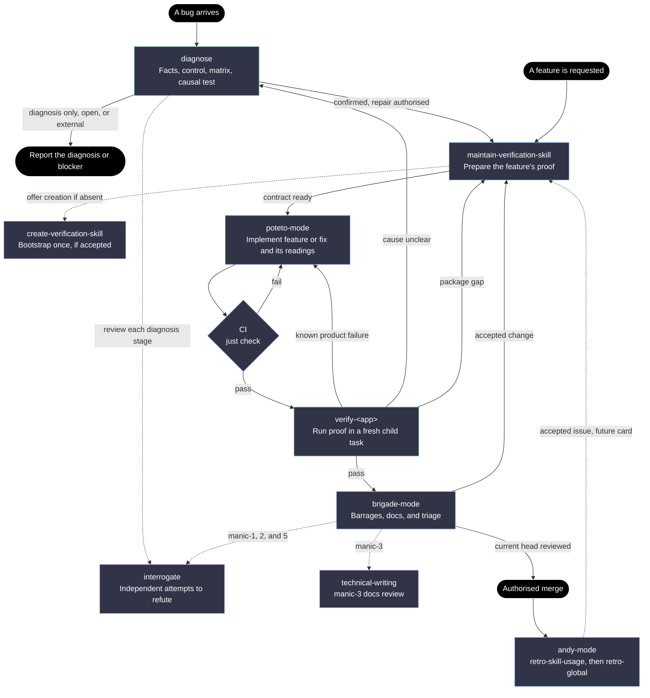

## 1. Why the rejected diagram confuses

The diagram uses "verify loop" for an execution gate and a separate destination, so the reader cannot tell whether it means instructions, a run, or future work. Its retro arrow appears to update that destination directly, bypassing the maintenance owner. It also shows adversarial review twice without making clear that diagnosis and barrages call the same service.

## 2. The workflow

Maintenance defines the proof. Product code supplies the readings. The project verifier executes the proof.

This diagram shows the normal application path in a brigade round. Solid arrows hand work to the next owner. Dotted arrows call a helper that returns to its caller, or queue a future card.

Each node has one read/write contract:

- F reads the feature request; writes intended behavior and acceptance criteria into the existing card
- B reads the bug report; writes the reported symptom, affected surface, versions, and available artifact pointers
- D reads those artifacts and the existing project's probes, controls, policy, and readings; writes a case with append-only facts, a hypothesis matrix, discriminating evidence, and a claim level
- O reads the case's outcome; writes a cited diagnosis, external-owner report, or the specific observation blocking progress
- P reads the card or confirmed case and the existing feature map; writes only the verification package's feature file, reading contract, harness changes, and negative-proof recipe
- G reads the repository's launch, drive, observe, and isolation capabilities; writes and proves the initial verification package, then returns it to P
- I reads the proof contract and feature or repair plan; writes product code, its default readings, and focused product tests
- C reads the exact candidate revision; writes the result of `just check`
- V reads the verification package, candidate revision, negative-proof recipe, and comparable last good evidence; writes retained readings, artifacts, coverage, and a proof verdict
- Q reads the current stack and proof evidence; writes review findings, triage decisions, and DocWriter's product-documentation changes
- H reads the same factual snapshot and the requested review angle in independent contexts; writes cited contradictions, evidence defects, or a checked null with coverage
- T reads the docs and final product diff; writes documentation findings for manic-3
- M reads green proof for the current head, completed reviews, and merge authority; writes the merged change and its accepted baseline reference
- R reads the session, case, interventions, diff, and proof evidence; writes retro issues or a recorded no-findings result

P is the sole upkeep owner after bootstrap. Its package contains the feature map, named readings, normal values or comparison rules, probes, controls, and verifier helpers. It selects a few readings that distinguish the feature's failure modes and records their collection cost. It edits no product code, preserving the existing [maintenance edit scope][maint]. A fix updates the affected feature file; it creates no separate map for bugs.

V is the sole execution owner. Creation and standalone maintenance audits also use this executor for their proof runs. They own when and what to verify, while the project skill owns launch, doctor, drive, evidence, and cleanup, as the [generator][create] already specifies. A live run writes evidence, never weaker expectations to make itself pass.

The Cook starts V with T3 `delegate_task`, retains its `taskId`, and inspects its actual evidence. The child gets the revision, contract, controls, and prior good run, without the author's explanation of why the change works. Candidate CI passes before this shared proof gate begins.

V proves both sensitivity and correctness. For a fix, the check uses the original probe to expose the reported strong signal on the unfixed revision and show it restored on the candidate. For a feature, a planted regression of the declared failure model makes the corresponding reading violate its contract, and the candidate passes. The candidate also satisfies the intended behavior, preserves other readings under their comparison rules, and records any missing or unreachable coverage. A new shallow reading promoted from diagnosis must track the original signal. Missing evidence for a required check blocks acceptance.

A missing package pauses preparation while the caller offers creation once. An accepted offer explicitly invokes G, whose current [trigger][create] requires explicit invocation. If the offer is declined and no exemption applies, the caller reports the missing proof capability. The project's explicit "no verify loop, CI is enough" policy skips P and V and suppresses that offer.

Brigade retains its existing order: manic-1, manic-2, DocWriter, manic-3, manic-5, then closing. Manic-1, 2, and 5 call H with their angle and `reviewers = 2`, one Claude and one Codex, read from each barrage's configuration. Diagnosis calls H at the control, matrix, and validation stages with one reviewer from another family. A null review records what was checked; it grants no causal confirmation or verification pass. These are changes to the current [interrogate][review] and [brigade SOPs][brigade], following the [post's elimination rule][post-review].

The Chef keeps ownership of triage and merge. Product-doc corrections stay with DocWriter; verification-package corrections return to P. Accepted code or harness changes invalidate the old proof, so the next candidate goes through CI and V again. A solo caller uses the same preparation and proof owners with its authorised review and shipping procedure.

## 3. The connection between the two use cases

They merge at P, when the caller can state what the change must prove. A feature supplies intended behavior and a failure model. A bug supplies a confirmed mechanism, the reading that exposed it, its control value, and any repro validated against that reading. Both become a maintained feature check before acceptance. For a sharded client, the feature contract checks which names it resolves. If a later diagnosis finds unsharded lookups, maintenance strengthens that same feature check, as the [build example][instrument] demonstrates.

They split before that merge because a bug's cause is an inference that needs factual constraints. D gathers facts before source-led hypotheses, pairs a control, eliminates matrix rows by cited contradictions, repairs an inadequate hypothesis set, and gathers one layer deeper when needed. A surviving candidate is only consistent; confirmation needs a discriminating causal test. This follows the [three-step loop][post-loop] and the stronger claim levels in the [method design][method].

They split again whenever V finds a failure whose cause is unclear. Its retained readings become the next case's facts. A known product failure returns to implementation; a proven harness or map defect returns to maintenance. The caller preserves the original feature card while investigating a failure discovered during that build.

The boundary belongs between causal knowledge and repair. Diagnosis writes evidence and a repair recommendation. Maintenance turns that evidence into a repeatable check. Implementation makes the change. Verification can declare the fix proven only when the original signal returns to its control value on the same surface, the symptom disappears, and residual checks pass.

This connection works in both directions. A feature's default readings give the next diagnosis a cheaper starting point. A diagnosis promotes its strongest reading into the feature's future check. The post's [integration-gating section][post-gate] makes that same connection, and the [method design][method] places the promoted reading at the shallowest useful layer.

R closes the learning loop through issues. Skill-rule defects go through retro-skill-usage; missing probes, controls, access, or checks go through retro-global's new verification category. Accepted issues become future cards and return through P when they concern the verification package. The [retro routes][retro] and [brigade closing SOP][closing] already support issues rather than direct environmental edits. Remote probes follow the loaded `fleet` skill and recorded access authority.

## 4. What I would change in the decisions

I keep the chosen skills, review owners, brigade barrages, delegated execution, retro routes, and both connections. I would refine these requirements:

1. **Decision 4: choose proof before coding, require negative proof before acceptance.** A new feature cannot have a meaningful planted regression until executable behavior exists. Prepare its reading contract and failure recipe first, then let V execute the planted variant and candidate after CI. For a fix, V can replay the unfixed revision, preserving failing-check-before-fix commit order. Evidence: the [method design's build steps][instrument] put emission before planted-regression proof, and [bug-fix step 5][bug-fix] requires the failing repro before the fix in history
2. **Decision 4: give maintenance a focused add-or-change pass.** The existing audit reads and drives every mapped feature and ships its own correction PR. A build-time call prepares the affected feature's package changes in the Cook's existing worktree, returns the contract, and relies on the shared V gate to prove them. It also handles fixes and accepted retro cards. Keep the full audit for explicit upkeep, with all live execution following the project verifier. Evidence: [maintenance steps 2, 4, and 6][maint] require whole-map coverage and a separate shipping outcome; [brigade's one-writer rule][brigade] requires serial handoffs within the Cook's worktree
3. **Decision 5: make "last good" explicit and comparable.** Pin its revision and run artifact; state fixtures, flags, environment, comparison rules, and intended differences before the candidate run. New readings use declared normal values until they have an accepted baseline. Failed, incomplete, and planted runs never replace that baseline. Evidence: the [method design][method] requires controls, a noise floor, and declared changes; the real [verify-transcript loop][real-loop] retains commands, durations, observations, and run results but does not yet define baseline promotion

The accepted decisions also require concrete integration edits. [Bug-fix step 2][bug-fix] currently seeds hypotheses from source; it must hand diagnosis to D. [Feature step 5][feature] must use the shared CI-then-V gate. [Interrogate][review] currently hard-codes four reviewers and weights consensus; its count must become caller-supplied, and findings must stand on cited evidence. The [real feature map][real-map] currently has four sections; the new reading contract must be added consistently by creation and maintenance.

## 5. Questions only Pascal can answer

1. Which read-only production probes, if any, may diagnosis run on the fleet without fresh approval?
2. Should accepted verification gaps from retros become required next cards, or enter the ordinary prioritised backlog?

[maint]: ../../../../../authoring/poteto/maintain-verification-skill/SKILL.md#L21
[create]: ../../../../../authoring/poteto/create-verification-skill/SKILL.md#L3
[review]: ../../../../../authoring/poteto/interrogate/SKILL.md#L38
[brigade]: ../../../../../authoring/andy-devtools/brigade-mode/playbooks/arancini/arancini.md#L80
[closing]: ../../../../../authoring/andy-devtools/brigade-mode/playbooks/arancini/sop/chef-closing.md#L17
[retro]: ../../../../../authoring/andy/andy-mode/playbooks/retro-global.md#L10
[method]: design-round-1.md#L28
[instrument]: design-round-1.md#L229
[bug-fix]: ../../../../../authoring/poteto/poteto-mode/playbooks/bug-fix.md#L14
[feature]: ../../../../../authoring/poteto/poteto-mode/playbooks/feature.md#L19
[real-loop]: ../../../../../authoring/verify-loops/verify-transcript/SKILL.md#L61
[real-map]: ../../../../../authoring/verify-loops/verify-transcript/features/README.md#L30
[post-loop]: /tmp/debug-post/post.txt:705
[post-review]: /tmp/debug-post/post.txt:1161
[post-gate]: /tmp/debug-post/post.txt:1364

